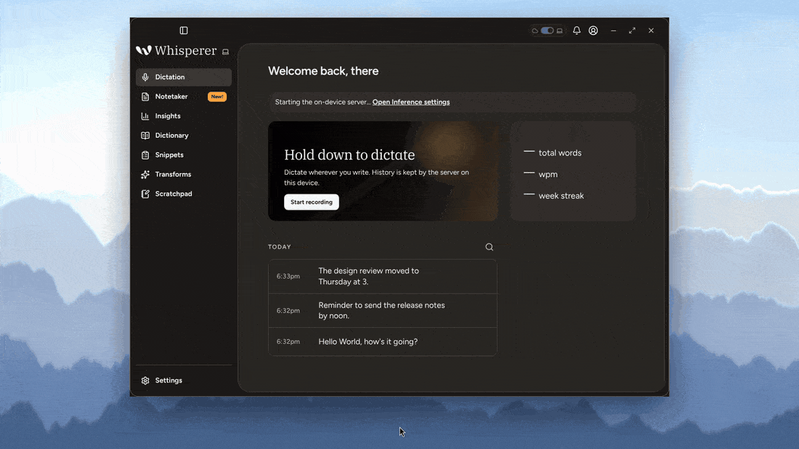

  <picture>
    <source media="(prefers-color-scheme: dark)" srcset="assets/brand/raster/logo-dark-1170.png">
    
  </picture>

<strong>Hold a key, speak, and polished text lands in any app. Private by default, on your machine.</strong>

  
  
  
  

  

## Why Whisperer

- **Dictate anywhere.** Hold a shortcut, talk, release. Text is typed into whatever app has focus.
- **Never leave a meeting empty-handed.** Record one and get a transcript, an editable summary, and answers to questions about what was said.
- **Your data stays yours.** Speech recognition runs on-device. No account, no telemetry, no cloud required.
- **Fast on modest hardware.** An hour of audio transcribes in about 3 minutes on a 2019 laptop, CPU only ([benchmarks](docs/benchmarks.md)).
- **Bring your own AI.** Self-host the server and plug in OpenAI, Ollama or any OpenAI-compatible endpoint.

## Engineering

Designed and built solo, with AI coding agents (Claude Code) under my direction: Electron/TypeScript client, FastAPI server, ONNX inference runtime, CI and release pipeline.

- **Hardened IPC.** Sandboxed renderer, `contextIsolation`, strict CSP, Zod-validated bridge in both directions, Electron fuses flipped at pack time ([`protocol.ts`](src/desktop/shared/protocol.ts)).
- **Supply-chain-pinned inference.** ONNX models locked to commit and SHA-256, staged then atomically promoted, re-hashed before load ([`model_store.py`](apps/api/src/whisperer_api/model_store.py)).
- **Authenticated loopback server.** Boot token over stdin only, `instanceId` health check plus HMAC challenge before trusting the port ([`local_auth.py`](apps/api/src/whisperer_api/local_auth.py)).
- **Contract-first.** FastAPI OpenAPI to generated TypeScript client, CI fails on drift ([`generate-api-client.mjs`](tools/generate-api-client.mjs)).
- **Local-first sync.** ID-keyed merge, last-write-wins on `updatedAt`, tombstoned deletes, audio never synced ([`sync.py`](apps/api/src/whisperer_api/sync.py)).
- **OIDC auth and a read-only MCP endpoint** for AI clients ([`mcp_server.py`](apps/api/src/whisperer_api/mcp_server.py)).

## Try it

**[Download the latest release →](https://github.com/sharukeshalagiri/Whisperer/releases)** for macOS, Windows or Linux, then pick **Continue without signing in** and start talking. [Full guide](docs/getting-started.md)

Self-hosting, MCP and the architecture are in the [docs](docs/README.md). MIT licensed.
