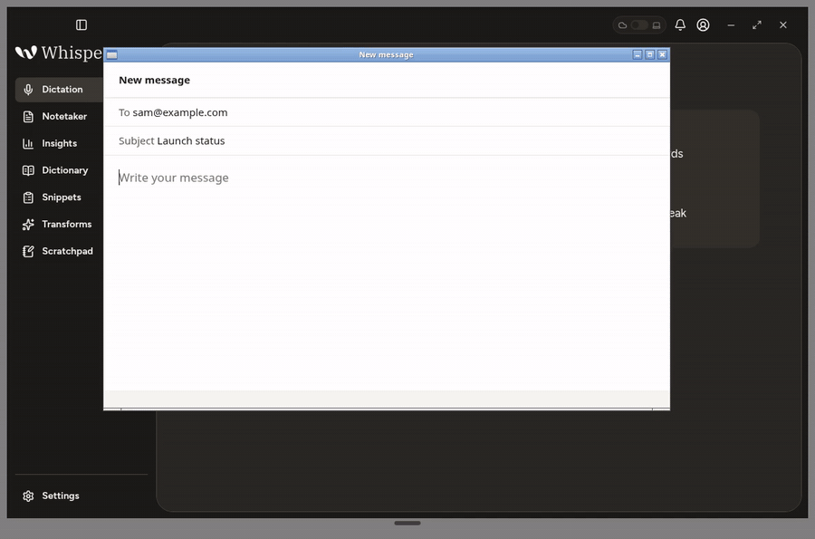
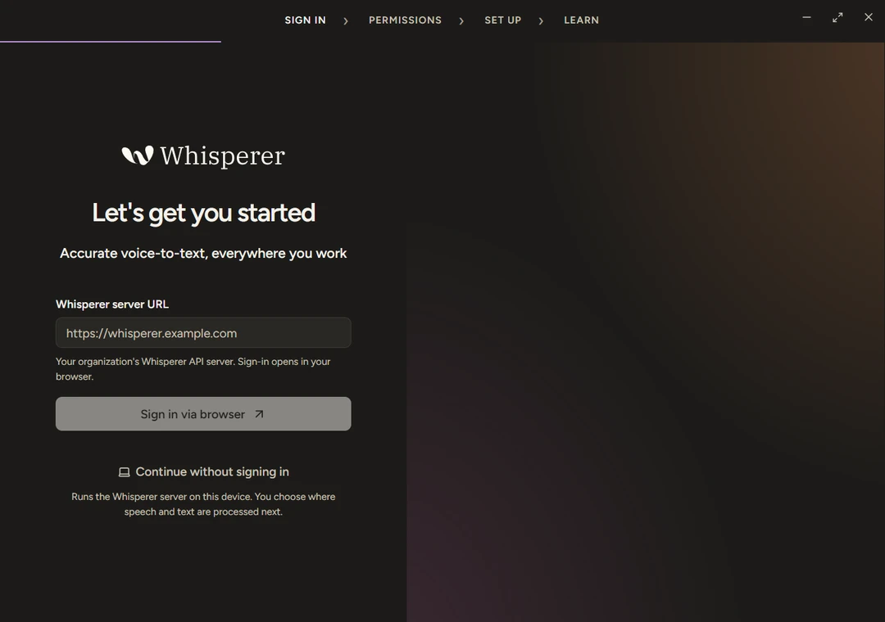
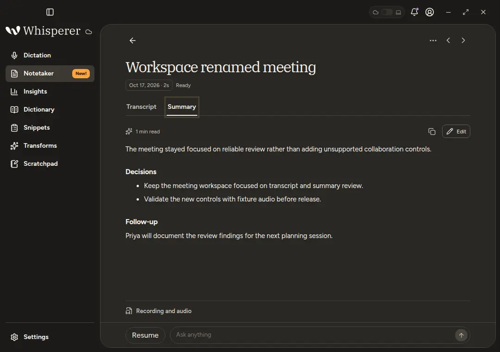
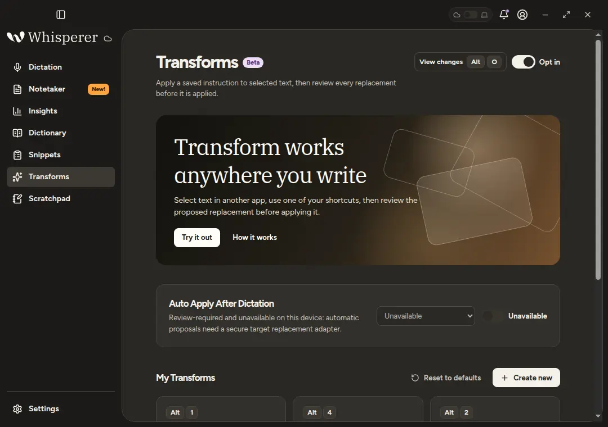
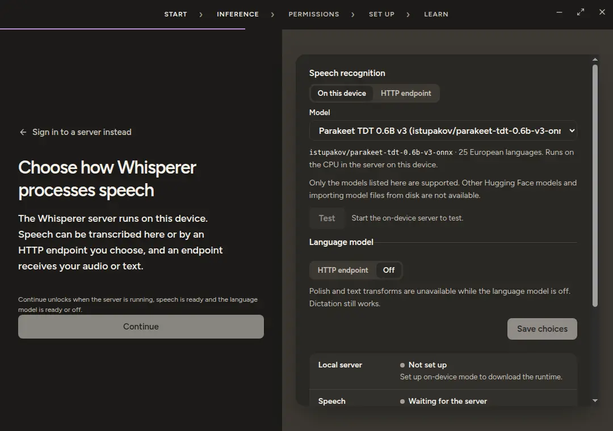
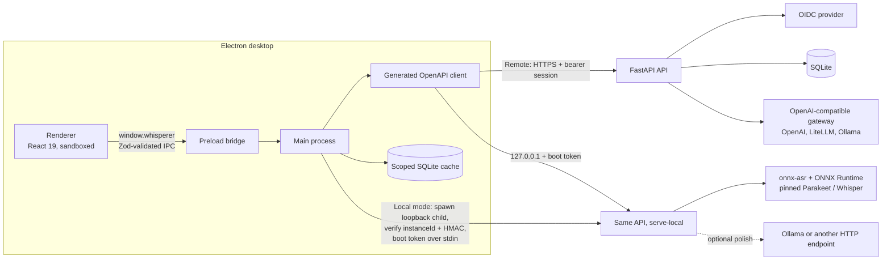

<p align="center">
  <picture>
    <source media="(prefers-color-scheme: dark)" srcset="assets/brand/raster/logo-dark-1170.png">
    
  </picture>
</p>

<p align="center"><strong>An open-source, self-hosted, privacy-first desktop dictation and meeting-notes app.</strong></p>

<p align="center">
  <a href="https://github.com/sharukeshalagiri/Whisperer/actions/workflows/ci.yaml"></a>
  <a href="LICENSE"></a>
  <a href="https://github.com/sharukeshalagiri/Whisperer/releases"></a>
  
  
  
  
</p>

<p align="center">
  
</p>

Hold a shortcut, speak, and Whisperer types polished text into whatever app has focus. Record a meeting and get a transcript, an editable summary and answers to questions about what was said. Everything runs against a FastAPI server you control, or, with **Continue without signing in**, against the same server running on your own computer with on-device speech recognition.

- **Self-hosted.** Sign in through your own OpenID Connect provider and pick the inference: OpenAI, LiteLLM, Ollama or any OpenAI-compatible endpoint.
- **Local mode.** No account and no server. Pinned ONNX speech models run on this computer.
- **No telemetry.** No analytics, crash reporting or tracing. Diagnostics stay in a local log file.
- **Honest about data flow.** The UI says where audio and text are sent. Any HTTP endpoint you configure receives them, even on localhost.

The demo above is a real recording of a Linux build against synthetic fixture data. The text is pasted into a separate window through the actual X11 insertion path.

## Why it's interesting

- **A sandboxed Electron app with a validated bridge.** Every window runs with `sandbox`, `contextIsolation` and a strict Content-Security-Policy, and loads only from a privileged `whisperer://` protocol. The renderer reaches the main process only through named methods. Each request and response is checked against Zod schemas in [`shared/protocol.ts`](src/desktop/shared/protocol.ts), in [main](src/desktop/main/index.ts) on the way in and in the [preload bridge](src/desktop/preload/index.ts) on the way out. Packaged builds flip Electron fuses in [`after-pack.cjs`](tools/after-pack.cjs).
- **Contract first, from FastAPI to TypeScript.** The API exports [`openapi.json`](apps/api/openapi.json), and [`generate-api-client.mjs`](tools/generate-api-client.mjs) turns it into the [typed client](packages/api-client) the desktop uses. CI regenerates both and fails if either is stale, so the two sides cannot drift.
- **On-device speech you can verify.** The [model store](apps/api/src/whisperer_api/model_store.py) pins Parakeet and Whisper ONNX models to exact commits, with the size and SHA-256 of every file. Downloads stream into a staging folder and are moved into place only when every file matches, and files are hashed again before loading. The runtime itself, `uv`, Python and the locked API packages, is pinned the same way in [`runtime-manifest.json`](src/desktop/main/runtime/runtime-manifest.json).
- **A local server that proves it is yours.** Local mode starts the API as a loopback child process. [`LocalServerService`](src/desktop/main/runtime/LocalServerService.ts) sends its boot token only on the child's stdin, never in argv, the environment or a file. It trusts the port only after the health check returns its own `instanceId` and the child answers an HMAC challenge ([`local_auth.py`](apps/api/src/whisperer_api/local_auth.py)).
- **A read-only MCP server.** AI clients sign in through your identity provider and can list, page through and ask about their own meetings, and nothing else. See [`mcp_server.py`](apps/api/src/whisperer_api/mcp_server.py) and [`mcp_meetings.py`](apps/api/src/whisperer_api/mcp_meetings.py).
- **Local-first sync with tombstones.** Local mode keeps its own data until you choose to sync. [`sync.py`](apps/api/src/whisperer_api/sync.py) merges snapshots by stable ID, lets the newer `updatedAt` win, carries deletions over as tombstones and never moves audio. [`DataSyncCoordinator`](src/desktop/main/runtime/DataSyncCoordinator.ts) runs one two-way sync at a time.

## Features

- **System-wide dictation.** Hold to talk or toggle hands-free. The text is inserted into the focused app on macOS, Windows and Linux X11, with a clipboard fallback where insertion is not available. [Get started](docs/getting-started.md#dictate)
- **Polish, dictionary and snippets.** An optional language model cleans up each dictation, a personal dictionary fixes names and jargon, and snippets expand saved text.
- **Transforms.** Apply a saved instruction to selected text in any app, then review the before and after. [Transforms](docs/getting-started.md#transforms)
- **Notetaker.** Record a meeting from the microphone, get a transcript and an editable summary, and ask questions answered from the saved meeting. [Notetaker](docs/getting-started.md#notetaker)
- **Read-only MCP endpoint.** Let an MCP client on your machine list, read and ask about your meetings, signed in through your identity provider. [Connect your AI app](docs/mcp.md)
- **Insights.** Words dictated, words per minute, streaks and a daily heat map, computed by the server from numbers only.
- **Sync between Local mode and a server**, in both directions, when you ask for it. [Local mode](docs/local-mode.md#keep-this-device-and-a-server-in-step)

| | |
| --- | --- |
|  |  |
| Sign in or continue in Local mode | Notetaker summary and questions |
|  |  |
| Transforms | Local mode inference setup |

## Architecture



- **One API for both modes.** Local mode runs the same FastAPI code as a server, so features, tests and the generated client are shared rather than duplicated in Electron.
- **Inference stays out of Electron.** Speech and language models run in the API process, which keeps the desktop small and lets a server use GPUs it owns.
- **The main process owns everything sensitive.** Windows, credentials (encrypted with `safeStorage`), the API client, the local SQLite cache partitioned by server and user, global shortcuts and native text insertion all live there. The renderer has no network access of its own.
- **Identity by issuer and subject.** Accounts are bound to the OIDC issuer and subject, never to an email address.
- **Honest capabilities.** Wayland insertion and system audio are reported as unavailable with a reason, and the UI never fabricates transcripts, metrics or claims of system audio capture.

| Layer | Technologies |
| --- | --- |
| Desktop | Electron 44.7, electron-vite 5, React 19.3, TypeScript 6.0, Tailwind CSS 4.3, TanStack Query 5, Zod 4.6, better-sqlite3 13, uiohook-napi 1.5 |
| Backend | Python 3.12, FastAPI 0.143, Uvicorn, SQLAlchemy 2.1, pydantic 2.14 and pydantic-settings, Authlib 1.8, joserfc, pydantic-ai 2.57, FastMCP 4.1 |
| Inference | onnx-asr 0.12, ONNX Runtime, NumPy, PyAV, or any OpenAI-compatible gateway (OpenAI, LiteLLM, Ollama, speaches) |
| Tooling | uv, npm, GNU Make, Ruff, mypy `--strict`, pytest, ESLint, Prettier, Vitest, node:test, Playwright (Electron driver), hey-api, electron-builder 26, Docker Compose, GitHub Actions |

## Quick start: Local mode in three steps

1. **Install.** Download the installer for your platform from [Releases](https://github.com/sharukeshalagiri/Whisperer/releases). Builds are unsigned, so macOS and Windows warn once; [Get started](docs/getting-started.md#install) explains how to open them.
2. **Continue without signing in.** On the sign-in screen, choose **Continue without signing in**. No account or server is needed.
3. **Set up and download a model.** Onboarding's Inference step installs the pinned runtime and downloads a speech model when you press the buttons, and not before. The runtime needs about 2 GiB of free disk space. **Whisper base** (about 108 MB) downloads much faster than **Parakeet TDT 0.6B v3** (about 670 MB).

Then hold the dictation shortcut and speak. [Local mode](docs/local-mode.md) lists what is downloaded, where it goes, and where audio and text are sent.

To run from source instead, you need Node.js 22.18 or newer, [uv](https://docs.astral.sh/uv/) and Python 3.12:

```sh
make setup      # install locked desktop dependencies and build the app
make desktop    # build and launch Electron
```

## Self-hosting

```sh
cp .env.example .env    # replace every CHANGE_ME
make api-up             # the API alone, against your existing gateway network
make stack-up STACK=cpu # or: the API with bundled inference
```

| Stack | Speech model | Language model | Notes |
| --- | --- | --- | --- |
| `cloud` | `gpt-transcribe` | `gpt-6-luna` | OpenAI or any OpenAI-compatible provider, no local services. Set `OPENAI_API_KEY`. |
| `cpu` | `Systran/faster-whisper-small` | `gemma3:1b` | speaches and Ollama on the CPU. |
| `nvidia` | `istupakov/parakeet-tdt-0.6b-v3-onnx` | `gemma3:4b` | Needs the NVIDIA Container Toolkit. |
| `apple` | `istupakov/parakeet-tdt-0.6b-v3-onnx` | `gemma3:1b` | Docker on macOS has no GPU; a native Ollama is faster. |

Without `STACK`, `make stack-up` picks `apple` on an Apple Silicon Mac, `nvidia` when `nvidia-smi` works, and `cpu` otherwise. Defaults live in `deploy/<stack>.env`, and `.env` overrides them. The API listens on port 14318; put a TLS reverse proxy in front of it. [Self hosting](docs/installation.md) has the full steps and [Configuration](docs/configuration.md) explains every setting, from the OIDC client and `PUBLIC_URL` to the gateway, model names and the optional MCP endpoint.

## Usage

- **Onboarding** checks permissions, tests the microphone and sets the language and the dictation shortcut, then runs a short tutorial. In Local mode it adds an Inference step.
- **Default shortcuts**, all changeable in Settings:

  | Action | macOS and Linux | Windows |
  | --- | --- | --- |
  | Push to talk (hold) | `Control+Alt` | `Control+Super` |
  | Hands-free start and stop | `Control+Alt+Space` | `Control+Super+Space` |
  | Paste last transcript | `Control+Command+V` on macOS, `Alt+Shift+Z` on Linux | `Alt+Shift+Z` |
  | Copy last transcript | `Control+Command+C` on macOS, `Alt+Shift+X` on Linux | `Alt+Shift+X` |
  | Open Scratchpad | `Alt+S` | `Alt+S` |
  | Start Notetaker | `Alt+M` | `Alt+M` |
  | Transform selection | `Alt+1` | `Super+Alt+1` |
  | View Transform changes | `Alt+O` | `Super+Alt+O` |
  | Cancel | `Escape` | `Escape` |

- **Dictation.** Hold the shortcut or click the pill, speak and release. The polished text is inserted into the focused app and kept in the local history.
- **Transforms.** Select text anywhere and press a transform shortcut. The replacement is pasted only if the same text is still selected, followed by a before and after review.
- **Meetings.** Start Notetaker from the pill or `Alt+M`. When it stops, the server transcribes and summarizes, and you can edit both or ask questions.
- **MCP clients.** Settings › MCP shows the connection URL and copyable setup for common clients. MCP is available on a server deployment with the MCP settings configured, not in Local mode. See [Connect your AI app](docs/mcp.md).

## Testing

```sh
make desktop-lint     # TypeScript type checks and ESLint with zero warnings
make desktop-test     # Vitest and node:test
make desktop-build    # production build
make api-lint         # Ruff and mypy --strict
make api-test         # pytest
make api-contract     # regenerate openapi.json and the client, fail if stale
make stack-config     # validate every Compose stack
make docs-check       # folder AGENTS.md, CLAUDE.md shims and README diagrams
```

CI runs these on every pull request and every push to `main`, then validates `compose.yaml` and builds the hardened API image. CodeQL scans the TypeScript and Python code once the repository is public, and Dependabot proposes weekly grouped updates. `node tools/drive-desktop.mjs` drives the built app end to end against a loopback fixture with a disposable profile.

## Project structure

```text
.
├── apps/api/                  FastAPI service, tests and openapi.json
│   └── src/whisperer_api/     HTTP adapters, auth, inference, meetings, sync, MCP, Local mode
├── packages/api-client/       TypeScript client generated from openapi.json
├── src/desktop/
│   ├── main/                  Electron main: runtime, services, storage, platform adapters
│   ├── preload/               Sandboxed window.whisperer bridge
│   ├── renderer/              React UI: recording, meetings, content, device, insights
│   └── shared/                IPC contract, Zod schemas, shortcuts, release naming
├── deploy/                    Compose overlays and per-stack model defaults
├── assets/                    Brand sources and generated artwork, screenshots
├── docs/                      User guide, developer reference and roadmap
├── tools/                     make commands, packaging, release and acceptance drivers
├── compose.yaml, Dockerfile   API container and base Compose service
└── Makefile                   Entry point for every command
```

Component READMEs go deeper: [deploy](deploy/README.md), [docs](docs/README.md), [tools](tools/README.md), the [API](apps/api/README.md), the [API client](packages/api-client/README.md) and the [desktop](src/desktop/README.md). Every folder also has an `AGENTS.md` with the rules for changing it.

## Roadmap

Whisperer is in beta. Physical-device verification on macOS and Windows, Local mode on more platforms, code signing and Wayland insertion are still open. The [roadmap](docs/roadmap.md) lists what has been verified on each platform, the known limitations and planned work, and the [changelog](CHANGELOG.md) records each release.

## Contributing and security

Contributions are welcome; [CONTRIBUTING.md](CONTRIBUTING.md) covers setup, checks and pull requests. Please report vulnerabilities privately through GitHub's private vulnerability reporting, as described in [SECURITY.md](SECURITY.md), never in a public issue.

## License

[MIT](LICENSE) © [Sharukesh Alagiri](https://github.com/sharukeshalagiri)
