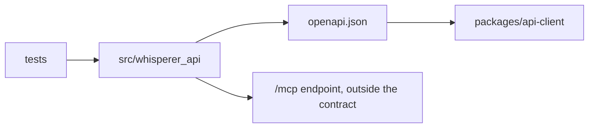

# apps/api

The FastAPI service and committed API contract.

## How it works

Use `make api-setup`, `make api-lint`, `make api-test`, and `make api-contract` from the repository root.

## Used by

The Electron main process consumes this service through the generated client.

## Structure

`src` implements the package and `tests` protects its behavior.

This workspace owns the FastAPI service and its published OpenAPI contract.

Run `make api-setup` before `make api-lint`, `make api-test`, or `make api-contract`. Run `make api-preflight` to validate configuration without serving HTTP.

The optional `local` extra (`uv sync --extra local`) adds onnx-asr, ONNX Runtime, NumPy and PyAV for the desktop's on-device `serve-local` profile. Remote deployments do not install it. Without it, the audio-decoding tests are skipped.

An opt-in remote MCP endpoint at `/mcp` lets an MCP client such as Claude Code read and ask about the signed-in user's own meetings through three read-only tools. It uses its own OAuth flow, is absent unless fully configured, never runs in the on-device profile and is not part of `openapi.json`. [docs/configuration.md](../../docs/configuration.md#remote-mcp-endpoint) lists its prerequisites.

| Path | Responsibility |
| --- | --- |
| src/ | Contains the `whisperer_api` implementation. |
| [tests/](tests/README.md) | Covers settings, authentication, readiness, and contract behavior. |
| `openapi.json` | Committed contract consumed by the generated desktop client. |
| `pyproject.toml` | Defines the service package, runtime dependencies and the optional `local` extra. |

The desktop is the external caller, either over HTTPS to a deployment or as the supervisor of an on-device `serve-local` process. Deployment configuration lives at the repository root and in [docs](../../docs/README.md).
