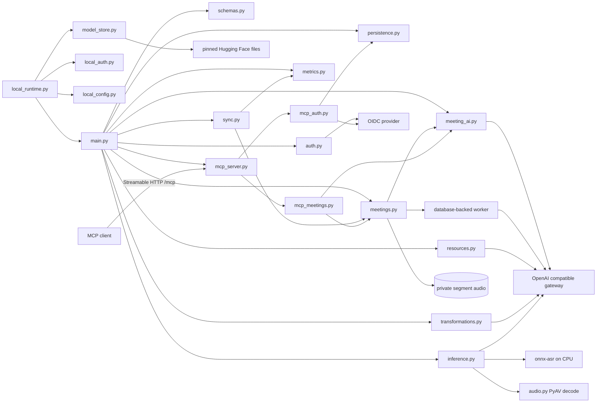

# apps/api/src/whisperer_api

HTTP composition, authentication, resources, persistence, settings, and maintenance commands.

## How it works

Use the root `make api-*` targets. The package also exposes `preflight`, `openapi`, `import-legacy` and `serve-local` through `python -m whisperer_api`.

## Used by

The generated API client and deployment container call its published routes and commands.

## Structure

`main.py` composes focused auth, resource, persistence, schema, settings, and readiness modules. With an on-device profile from `local_runtime.py`, the same composition swaps OIDC sessions for boot-token authentication and builds inference from the desktop's configuration.

`whisperer_api` builds the HTTP service, authenticates desktop sessions, and persists API owned data.

`main.py` creates the FastAPI app. Run `python -m whisperer_api preflight` or `openapi --output …` through the `make api-*` commands from the repository root. `import-legacy` opens its source database read-only and requires an explicit user mapping. After a successful OIDC callback, its no-token browser completion page opens the desktop with a verifier-protected device-code deep link.

Remote MCP is opt-in. When `Settings.mcp_configured` holds on a remote deployment, `main.py` builds the OAuth provider through an injectable factory and `mcp_server.py` mirrors the FastMCP routes into the parent router: `/mcp` plus root-level OAuth discovery, authorization, token, registration, consent and callback routes. They are plain Starlette routes, so none appears in `openapi.json`. The MCP lifespan runs inside the API lifespan, after schema creation and before the worker and HTTP clients close. A missing setting or a provider that fails to start logs one safe line and leaves the rest of the API serving. The on-device profile never mounts MCP. The server is stateless and exposes exactly three read-only tools: `list_meetings`, `get_meeting_text` and `ask_meeting`. `mcp_auth.py` maps a verified MCP access token to an existing user by exact issuer and subject, rejects ID tokens and wrong audiences, and builds the OIDC proxy with encrypted durable storage. `mcp_meetings.py` lists owned meetings without content, pages saved transcript or summary text by exact code points behind revision-bound cursors, and answers one ephemeral question from the complete saved snapshot. Foreign and absent meetings fail with the same message.

Dictation is stateless. The API transcribes, optionally polishes, applies the caller's backend dictionary once with whole-word matching, and returns the replacement count. The desktop keeps dictation text locally and submits only numerical metric events.

Meetings are backend owned. Each recording or resumed recording is a segment with a client-generated ID. Its audio is streamed to private storage and transcribed by one restart-safe worker that claims work with expiring leases. Transcript and summary edits use revisions and `If-Match`. A generated summary records its transcript revision and never overwrites a concurrent edit. `POST /v1/meetings/{meeting_id}/questions` is stateless: it authenticates ownership, snapshots the complete saved transcript and saved summary with their revisions in a short transaction, then releases the transaction before inference. It accepts only a question, never client-supplied meeting text, persists no chat history, and changes neither the meeting, dictionary nor metrics. The fixed inference instruction treats every supplied block as untrusted data; an upstream context-window rejection reports that no text was shortened. Meetings never consult the dictionary.

`meeting_ai.py` sends meeting answers and durable meeting summaries through Pydantic AI to the same OpenAI-compatible language-model endpoint and key as `inference.py`, over its own `httpx2` client. Each call is exactly one model request with a fixed instruction, the complete escaped saved text, no tools, no message history, no retries, an explicit output-token cap and no instrumentation. Plain-text output is stripped and must be non-empty and within its character bound. Provider text never reaches errors or logs. When the language model is off or unconfigured the service is absent, questions return 409 and summaries fail without retrying the provider. Note summaries stay on `InferenceRouter.summarize`.

Inference has two independent providers. Speech is an OpenAI-compatible HTTP endpoint or, on a device, a pinned ONNX catalog model run by onnx-asr. The language model is an HTTP endpoint or off. Remote deployments build both from `GATEWAY_*`, or from the optional `SPEECH_*` and `LLM_*` settings. When the language model is off, polish returns the dictated text unchanged, and summaries, transformations, and meeting questions return 409.

`serve-local` runs the API for one desktop on `127.0.0.1` with a SQLite database in the desktop's data directory. The desktop supervises the process. [docs/api-runtime.md](../../../../docs/api-runtime.md#on-device-server) defines the boot protocol.

Text transformations return a proposal only. Acceptance uses the existing note or meeting edit route, so its revision check protects newer content.

| Path | Responsibility |
| --- | --- |
| `main.py` | Composes routes, dependencies, and the meeting worker lifecycle for remote and on-device profiles. |
| `inference.py` | Independent speech and language-model providers (HTTP, ONNX, off) behind one router. |
| `meeting_ai.py` | Typed single-request Pydantic AI boundary for meeting answers and summaries. |
| `audio.py` | Decodes WAV, WebM and other uploads to 16 kHz mono with PyAV, used only by on-device speech. |
| `model_store.py` | Pinned speech-model catalog with verified, atomic, explicit downloads. |
| `local_config.py` | Validates the desktop's `local.json`, the stdin boot line and bounded stdout events. |
| `local_auth.py` | Boot-token authentication, the HMAC challenge and the persistent device user. |
| `local_runtime.py` | `serve-local`: loopback binding, the boot sequence, parent-exit detection and model downloads. |
| `meetings.py`, `meeting_models.py`, `meeting_schemas.py` | Own backend meetings, resumable recording segments, editable transcripts and summaries, private audio, and durable processing. |
| `metrics.py`, `metrics_models.py`, `metrics_schemas.py` | Store numerical dictation contributions and maintain incremental account aggregates. |
| `sync.py`, `sync_schemas.py` | `GET /v1/sync` exports a user's notes, dictionary, finished meeting text, metric events and deletion tombstones; `POST /v1/sync` merges another server's snapshot (newer `updatedAt` wins, tombstones apply, metrics combine by event id, audio never moves). |
| `transformations.py`, `transformation_schemas.py` | Produce reviewable text rewrites from inline or owned resource text without mutating the source. |
| `mcp_auth.py` | Fail-closed MCP token identity mapping, encrypted proxy storage and the lazily built OIDC proxy. |
| `mcp_server.py` | Builds the FastMCP server with the three read-only tools and mounts `/mcp` and its OAuth routes on the parent app with host and origin guards. |
| `mcp_meetings.py`, `mcp_schemas.py` | Read-only, owner-scoped meeting listing, exact text paging and questions for MCP tools. |
| `auth.py` | Implements OIDC, device authorization, and local sessions. |
| `persistence.py` | Defines isolated SQLAlchemy models and session boundaries. |
| `resources.py` | Owns user scoped notes, dictionary, and transcript services. |
| `schemas.py` | Defines strict public request and response representations. |
| `settings.py` | Validates environment configuration for remote deployments. |
| `preflight.py` | Performs sanitized OIDC and gateway readiness checks. |
| `legacy_import.py` | Migrates notes, transcripts and dictionary entries from Whisperer's earlier Node.js API database: dry run by default, explicit user mapping, read-only source. |
| `__main__.py` | Exposes preflight, OpenAPI export, `import-legacy` and `serve-local` commands. |

The desktop consumes the published routes through [packages/api-client](../../../../packages/api-client/README.md).
