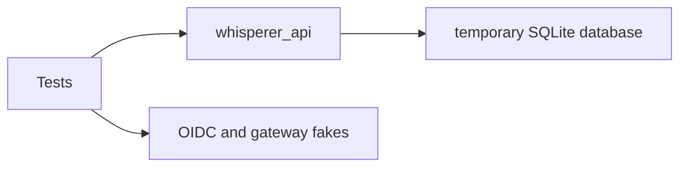

# apps/api/tests

API behavior and contract regression coverage.

## How it works

Run `make api-test` from the repository root with injected OIDC and gateway fakes.

## Used by

CI and maintainers call this suite.

## Structure

Each test module targets a service boundary such as settings, readiness, OIDC, or OpenAPI.

These tests validate the API without live external services.

Run them with `make api-test` from the repository root. The root Pytest configuration collects this directory.

| Path | Responsibility |
| --- | --- |
| `test_auth_resource_smoke.py` | Exercises device login, user owned resources, and logout. |
| `test_audio_deletion.py` | Simulates Windows file locks to check retried and reported audio deletion, the orphan sweep, and the worker dropping deleted segments. |
| `test_contract.py` | Protects OpenAPI operation IDs used by the generated client. |
| `test_oidc_issuer.py` | Checks issuer normalization and validation behavior. |
| `test_preflight.py` | Checks safe readiness reporting. |
| `test_settings.py` | Checks configuration parsing and validation. |
| `test_legacy_import.py` | Checks the earlier-database import against a temporary SQLite fixture: a dry run changes nothing, `--apply` copies only mapped users, reruns copy nothing new, and existing phrases are kept. |
| `test_timezones.py` | Checks that IANA time zones resolve without a system database, as on Windows. |
| `test_local_runtime.py` | Covers the `serve-local` boot protocol, boot-token auth, loopback guards, local routes and a real subprocess boot. |
| `test_local_inference.py` | Covers the speech and language-model providers, the gateway fallback, the language model being off, and PyAV decoding. |
| `test_model_store.py` | Covers the pinned catalog and verified, atomic model downloads. |
| `test_meeting_ai.py` | Covers the single-request Pydantic AI meeting boundary with `FunctionModel` and mock transports. |
| `test_mcp_auth.py`, `test_mcp_meetings.py` | Cover MCP identity mapping, encrypted proxy storage and the owner-scoped meeting adapter. |
| `test_mcp_server.py` | Drives the mounted `/mcp` endpoint with synthetic RS256 tokens through FastMCP's streaming ASGI transport: discovery, challenges, host and origin guards, the three tools, OpenAPI absence and lifespan unwinding. |
| `test_backend_workflows.py` | Exercises meetings, owner-scoped saved-context questions, metrics, dictionary and transformations through HTTP. |

The API implementation in src is the system under test. The generated client is an external contract consumer.
