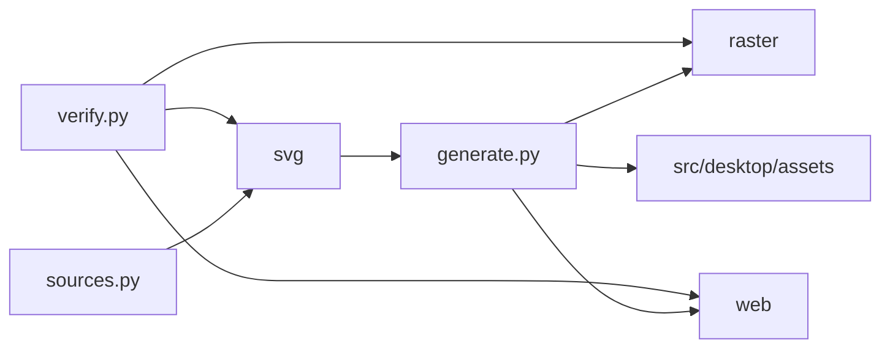

# assets/brand

Editable brand definitions and generated artwork output.

## How it works

Edit `sources.py`, then run `sources.py` and `generate.py` through `make brand`. Run `verify.py` after generation.

## Used by

Desktop packaging and a future web root consume the generated assets.

## Structure

`sources.py` creates SVG definitions and `generate.py` derives raster, web, and desktop copies.

This folder owns editable brand definitions and all generated logo, icon, PWA, and desktop asset outputs. It generates edge-tight, theme-specific sidebar lockups and matching background-backed app-icon SVGs for the desktop rail.

Run `make brand-setup` and then `make brand` from the repository root. Run `assets/brand/.venv/bin/python assets/brand/verify.py` on Linux and macOS after generation. Cairo is required by CairoSVG.

| Path | Responsibility |
| --- | --- |
| `sources.py` | Defines the editable vector artwork and outlined wordmark. |
| `generate.py` | Renders derived raster, PWA, and desktop assets. |
| `verify.py` | Checks dimensions, transparency, safe zones, manifests, and desktop copies. |
| `svg/` | Generated light and dark logos, marks, icons, and favicon. |
| `raster/` | Generated PNG, ICO, and ICNS variants. |
| `web/` | Generated PWA icon and manifest bundle for a future web root. |
| `fonts/` and `licenses/` | Hold generation fonts and their licenses. |
| `requirements.txt` | Defines the optional artwork generation dependencies. |

The PWA bundle is asset output, not a web application or service worker. src/desktop/assets is the external desktop consumer.
