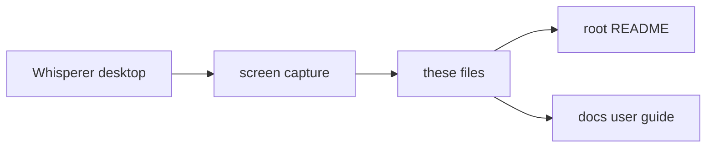

# screenshots

Captured Whisperer application screens used in the README and the user guide.

## How it works

Screenshots are captured from a running Whisperer build, not generated. Each file is named `<surface>-<screen>-<theme>-<width>.<ext>`, where width is the pixel width. The 1080 wide captures come from the Linux acceptance run under `tools/drive-desktop.mjs` against the loopback fixture, so their content is synthetic.

The demo GIF was recorded from a Linux build on an isolated Xvfb display in Docker, against the same loopback fixture, with a fresh temporary profile. The dictation is pasted into a separate window through the real X11 insertion path and the transform runs in place, so nothing in it is mocked up beyond the fixture's synthetic server responses. Its metadata is stripped.

## Used by

The [root README](../../README.md) and the pages in [docs](../../docs/README.md) embed these files.

## Structure

The files are leaves with no imports between them.

| Entry | Role |
| --- | --- |
| `desktop-demo-dark-900.gif` | 23 second demo: dictation pasted into a mail window, a transform applied in place with its review, a Notetaker summary, and Settings › Inference after switching to Local mode. |
| `desktop-dictation-home-dark-1080.webp` | Dictation home in Local mode before the runtime is set up, with an empty history. |
| `desktop-sign-in-dark-1080.webp` | Sign in screen with the server URL field and `Continue without signing in`. |
| `desktop-onboarding-permissions-dark-1080.webp` | Permissions step of onboarding. |
| `desktop-onboarding-inference-dark-1080.webp` | Inference step of onboarding in Local mode, before the runtime is set up. |
| `desktop-pill-hover-dark-262.webp` | Side docked pill with hover actions and tooltips. |
| `desktop-notetaker-summary-dark-1080.webp` | A meeting open on its Summary tab with Resume and Ask anything. |
| `desktop-transforms-dark-1080.webp` | Transforms screen with the opt in toggle and saved transform cards. |
| `desktop-settings-mcp-dark-1080.webp` | Settings › MCP with the connection URL and quick setup rows. |
