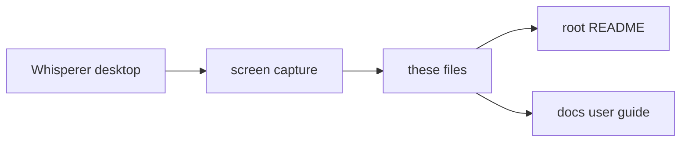

# screenshots

Captured Whisperer application screens used in the README and the user guide.

## How it works

Screenshots are captured from a running Whisperer build, not generated. Each file is named `<surface>-<screen>-<theme>-<width>.<ext>`, where width is the pixel width. The 1080 wide captures come from the Linux acceptance run under `tools/drive-desktop.mjs` against the loopback fixture, so their content is synthetic.

The demo GIF was recorded from the released 0.2.0-beta.2 Linux `.deb` on an isolated Xvfb display in Docker, with a fresh temporary profile in Local mode. A synthetic spoken sentence (espeak-ng) plays through a fake microphone, the Whisper base model transcribes it on the computer, and the text is pasted into a separate GTK window through the real X11 insertion path. The only data in it is the example.com placeholder in that window. Its metadata is stripped.

## Used by

The [root README](../../README.md) and the pages in [docs](../../docs/README.md) embed these files.

## Structure

The files are leaves with no imports between them.

| Entry | Role |
| --- | --- |
| `desktop-demo-light-900.gif` | 42 second demo in Local mode: a spoken sentence transcribed on this computer and pasted into a mail window, then shown in History and Insights. |
| `desktop-demo-dark-1100.gif` | 16 second demo in Local mode, dark theme: a spoken sentence recorded and transcribed on this computer, then shown in History and Insights. |
| `desktop-dictation-home-dark-1080.webp` | Dictation home in Local mode before the runtime is set up, with an empty history. |
| `desktop-sign-in-dark-1080.webp` | Sign in screen with the server URL field and `Continue without signing in`. |
| `desktop-onboarding-permissions-dark-1080.webp` | Permissions step of onboarding. |
| `desktop-onboarding-inference-dark-1080.webp` | Inference step of onboarding in Local mode, before the runtime is set up. |
| `desktop-pill-hover-dark-262.webp` | Side docked pill with hover actions and tooltips. |
| `desktop-notetaker-summary-dark-1080.webp` | A meeting open on its Summary tab with Resume and Ask anything. |
| `desktop-transforms-dark-1080.webp` | Transforms screen with the opt in toggle and saved transform cards. |
| `desktop-settings-mcp-dark-1080.webp` | Settings › MCP with the connection URL and quick setup rows. |
