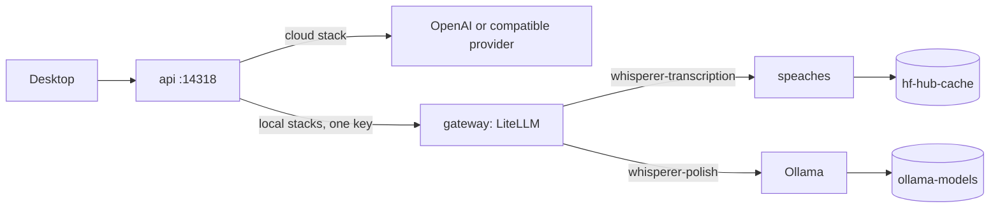

# deploy

Compose overlays that run the API with its inference in one command: in the cloud through OpenAI or another OpenAI-compatible provider, or on your own Apple silicon, NVIDIA or CPU hardware.

## How it works

The root `compose.yaml` stays the production base. Every stack's `.env` file picks its models, and `make stack-up STACK=<stack>` combines the files as the Compose project `whisperer-stack`.

The `cloud` stack adds nothing but settings. `cloud.env` points `GATEWAY_BASE_URL` at `https://api.openai.com/v1`, and `compose.cloud.yaml` takes the key from `OPENAI_API_KEY`. OpenAI already serves transcription, chat completions and `/models` under one base URL, so the API calls it directly:

```sh
docker compose -p whisperer-stack --env-file deploy/cloud.env -f compose.yaml -f deploy/compose.cloud.yaml up
```

The local stacks add three services on a private network and point the API at them. `compose.local.yaml` holds what they share; one hardware overlay picks the speaches build and device:

```sh
docker compose -p whisperer-stack --env-file deploy/<stack>.env \
  -f compose.yaml -f deploy/compose.local.yaml -f deploy/compose.<stack>.yaml up
```



In the local stacks the API addresses two stable aliases, `whisperer-transcription` and `whisperer-polish`. `litellm.yaml` routes them to the models chosen in the stack's `.env` file. The gateway exists because the API needs transcription, chat completions and one `/models` list behind a single base URL. speaches serves only speech and Ollama serves only chat.

| Stack | Hardware | speaches build | Speech model | Polish model |
| --- | --- | --- | --- | --- |
| `cloud` | Any host with internet | none | `gpt-transcribe` | `gpt-6-luna` |
| `apple` | Apple silicon Macs (M series) | `0.9.0-rc.3-cpu`, linux/arm64 | `istupakov/parakeet-tdt-0.6b-v3-onnx` | `gemma3:1b` |
| `nvidia` | Linux with an NVIDIA GPU | `0.9.0-rc.3-cuda-12.6.3` | `istupakov/parakeet-tdt-0.6b-v3-onnx` | `gemma3:4b` |
| `cpu` | Any x86-64 or ARM64 host | `0.9.0-rc.3-cpu` | `Systran/faster-whisper-small` (int8) | `gemma3:1b` |

speaches runs faster-whisper (CTranslate2) and Parakeet (ONNX Runtime). It does not use whisper.cpp. Docker on macOS runs Linux containers in a VM without the Apple GPU, so the Apple stack uses the ARM64 CPU build. Parakeet's ONNX model still runs faster than real time there. For Metal-accelerated polish, run the native Ollama app and set `OLLAMA_BASE_URL=http://host.docker.internal:11434`; the bundled Ollama container is then skipped.

speaches downloads its model during the first start (`PRELOAD_MODELS`), and `ollama-pull` fetches the polish model, so the first `make stack-up` of a local stack can take several minutes. Both persist in named volumes. speaches writes no logs, matching the privacy boundary of the production speech server. The NVIDIA overlay caps ONNX Runtime at 4 GiB per session and probes real transcription, because `/health` can stay green after a GPU out-of-memory failure.

| File | Responsibility |
| --- | --- |
| `compose.cloud.yaml`, `cloud.env` | Cloud stack: provider URL, key and models, no local services. |
| `compose.local.yaml` | Shared gateway, speaches and Ollama services, and the API's switch to them. |
| `compose.apple.yaml`, `apple.env` | Apple silicon overlay and model defaults. |
| `compose.nvidia.yaml`, `nvidia.env` | NVIDIA overlay, GPU reservations, memory cap and functional probe. |
| `compose.cpu.yaml`, `cpu.env` | CPU-only overlay and small-model defaults. |
| `litellm.yaml` | Gateway aliases, with prompt logging and vendor telemetry off. |

## Used by

Operators run `make stack-up`, `make stack-status` and `make stack-down` (see [self hosting](../docs/installation.md)). CI runs `make stack-config`.

## Structure

The overlays extend the root [compose.yaml](../compose.yaml) and its `api` service from [apps/api](../apps/api/README.md). They change no API code; the API sees an ordinary OpenAI-compatible endpoint, as in [configuration](../docs/configuration.md).
