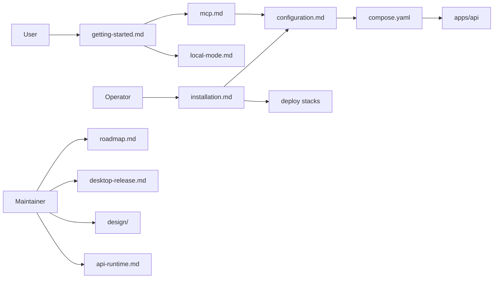

# docs

Everything a person reads about Whisperer that is not code. The user guide tells someone how to install and use the product or run a server for others. The developer reference records how the implementation works and what is still open.

## User guide

| Page | Covers |
| --- | --- |
| [Get started](getting-started.md) | Install the desktop, choose Cloud or Local mode, set up this device, dictate, Notetaker, transforms, shortcuts and Settings. |
| [Self hosting](installation.md) | Run the server with cloud or local inference sized to the hardware, choose models and expose it over HTTPS. |
| [Local mode](local-mode.md) | What the on-device server downloads, where audio and text go, sync with a server, erase and the known limits. |
| [Connect your AI app](mcp.md) | What the MCP endpoint exposes and how to add it to Claude Code, Codex, Cursor, Gemini CLI or another app. |
| [Configuration](configuration.md) | Every server setting, the production deployment steps, readiness, backups, certificates, the MCP operator setup and the inference stack variables. |

## Developer reference

| Page | Covers |
| --- | --- |
| [API runtime](api-runtime.md) | Backend ownership, the meeting lifecycle, dictionary scope, numerical metrics, reviewed transformations, the MCP adapter and the on-device boot protocol. |
| [Desktop release](desktop-release.md) | Reproducible committed desktop builds, naming, versioning, the update feed and publishing. |
| [On-device mode design](design/on-device-mode.md) | Intent, the local server contract, inference, runtime installation and failure behavior of Local mode. |
| [AI services and MCP design](design/ai-services-mcp.md) | Typed meeting AI calls and the authenticated, read-only MCP endpoint. |
| [Roadmap](roadmap.md) | Platform status, known limitations and planned work. |

## How it works

A user guide page opens with what the thing is and shows a screenshot from `assets/screenshots` before the detail. It names what the feature costs as well as what it does, and it never claims zero egress for Local mode. Configuration requirements belong in `configuration.md` and nowhere else, and examples carry no secret values.

## Used by

Users, operators and maintainers read these pages. The [root README](../README.md) links every user guide page, and `apps/api`, `deploy` and `tools` link into the developer reference.

## Structure

[apps/api](../apps/api/README.md) implements the documented service.
