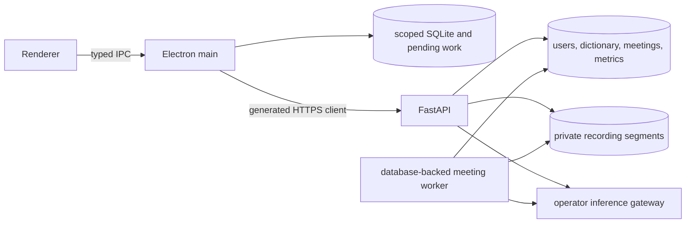

# Backend-owned desktop content

The backend owns meetings, dictionary entries and numerical account metrics. The desktop owns capture, paste, local dictation history and a scoped content cache. Text transformations return proposed replacements and never save or paste them automatically.

`apps/api/openapi.json` is the generated wire contract.

## Ownership and interactions



API authorization resolves the local user from the application's revocable bearer session. Every resource query is owner scoped. The renderer receives no credentials. Gateway credentials and upstream OIDC credentials remain in the backend.

## Dictation and dictionary

`POST /v1/transcriptions` accepts bounded multipart audio and returns an inference result without creating a server transcript row. Existing result fields remain available. `dictionaryReplacements` reports the actual substitution count.

The dictionary remains in a backend table associated with each user. Substitutions run once after optional polish, use word boundaries and longest matches, and do not reprocess inserted text. The desktop applies spoken snippets locally after the result returns. Meeting transcription, summaries and general text transformations never consult the dictionary.

Historical server transcript routes remain compatibility surfaces while clients migrate. They must not become the new desktop history source. Previously stored rows are not erased by schema initialization.

## Meetings

A meeting owns ordered recording segments. A recording session produces one stable segment ID. Uploading the same segment again with identical audio is idempotent. A conflicting upload is rejected. Audio bytes are stored privately and never in the database.

The desktop may record while offline. Its scoped queue retains the segment until the backend acknowledges it. Resuming uses the same meeting ID and creates another segment without replacing earlier audio or transcript edits.

The database worker processes one claimed operation at a time. Network inference happens outside database transactions. Expiring leases and conditional completion writes prevent crashes or late results from losing work or overwriting newer edits. Bounded retry handles transient failures. Segment failure remains visible independently of summary failure.

Deleting an account or all Local mode data commits the row deletions first and removes audio files afterwards, so a file that cannot be removed never leaves rows pointing at missing audio. On Windows a file another process still holds open (antivirus, or the worker reading it) is retried briefly; whatever remains is logged by storage path. An orphan sweep deletes audio that no segment row references at startup and before every account or local data deletion, skipping files younger than a grace period so an upload that has not committed yet is never touched. A worker whose segment is deleted mid-read, or mid-transcription, drops the result quietly. The startup orphan sweep assumes a single API instance per audio directory, so running multiple replicas that share audio storage is not supported.

Finishing a meeting requests a summary after pending segments are transcribed. A readable transcript remains available even if summarization fails. An explicit regeneration request summarizes the current saved transcript, including user edits.

Transcript and summary edits use independent revisions. Reads expose `ETag`, and writes require `If-Match`. Editing or extending the transcript marks an existing summary outdated rather than deleting it. Generation captures transcript and summary revisions and does not overwrite concurrent edits. A deleted meeting invalidates outstanding work and removes its owned audio.

List reads use cursor pagination. The meeting representation includes processing states, content revisions and summary freshness. Polling stops when work finishes or the view closes. No broker, workflow engine, NDJSON upload, original refinement stage, generic jobs API or live push transport is required.

## Metrics

The desktop sends only numerical contributions through an idempotent event ID. A contribution contains output words, corrected words (raw transcript words changed before output by dictionary, polish or snippet expansion), recording duration, optional measured speech duration, dictionary replacement count, timestamp, the event's IANA time zone and optional app identity. It contains no transcript, audio, screenshot or diagnostic data.

A unique owner/event key prevents duplicate counting. Insertion and the lifetime, per-day and per-app aggregate updates commit in one transaction. Dashboard totals survive local history deletion. A cache failure is unavailable data, not a successful zero result.

`GET /v1/metrics` returns lifetime totals (words, duration, dictations, dictionary replacements, corrected words), recent words per minute, words today, this week, this month and last month, active days, the current and longest day streaks and the week streak. `GET /v1/metrics/daily?from&until` returns per-day words, duration, dictations, replacements and corrections for at most 366 days. `GET /v1/metrics/apps` returns words, duration and dictations per application label.

Recent WPM is the weighted rate over the latest 100 contributions with output words greater than zero and recording duration under 400 seconds. Speech duration is used when measured, otherwise recording duration. This is output-word rate, not necessarily spoken-word rate after polishing or snippet expansion.

Per-day rollups are keyed by the calendar date in the event's own time zone, so a dictation counts on the day the person made it. Reads sum rollups by date across every zone, so a day recorded on another device's clock still appears once on the viewer's calendar after a sync. The viewer's `timeZone` only decides which date is today and where the Sunday week and the month begin. Streaks use real consecutive calendar periods. Unrecoverable original server formulas are not invented. Time saved, correction accuracy and mobile totals remain unavailable without defined inputs.

Meeting and transformation output never increments dictation word counts, WPM, streaks or dictionary use. User-owned account metrics are product data, not a vendor analytics transport.

## Text transformations

`POST /v1/text-transformations` supports polish, shorten, expand, tone, translate and custom instructions. It accepts inline text or an owned resource reference. Referenced content is checked for ownership and expected revision before inference.

The result is a proposed replacement. The desktop previews it and offers explicit copy or apply. Meeting acceptance uses the existing conditional transcript or summary edit operation. Note acceptance crosses the note save barrier. A changed draft or stale revision is never replaced by a delayed result.

The API does not retain inline submitted text or generated proposals. Input and output text are not logged. Requests have bounded gateway timeouts and safe errors.

## Efficiency

- Index meeting lists by owner and update order.
- Uniquely index meeting segment IDs and metric event IDs.
- Update numerical aggregates incrementally rather than scanning full dictation history.
- Read at most 100 contributions for recent WPM.
- Bound daily chart ranges and list page sizes.
- Store only current edited content and necessary processing state rather than every intermediate generation.
- Treat large transcription uploads as an explicit format or size failure rather than silently truncating audio.

## MCP endpoint

A remote deployment can also serve an authenticated MCP endpoint at `https://<host>/mcp` once an operator enables and configures it as described in [configuration.md](configuration.md#remote-mcp-endpoint). It exposes three read-only tools:

| Tool | Scope | Returns |
| --- | --- | --- |
| `list_meetings` | `meetings:read` | The caller's meetings, newest first, as metadata only. Pass `nextCursor` back to page. |
| `get_meeting_text` | `meetings:read` | One exact page of the saved transcript or summary. Concatenating the pages reproduces the saved text. |
| `ask_meeting` | `meetings:ask` | An answer from the complete saved transcript and summary, with the revisions used. Nothing is saved. |

The tools call the same owner-scoped meeting services as the HTTP routes. They never loop back over HTTP and never write meeting content. The endpoint is stateless Streamable HTTP. It uses its own OAuth flow, so desktop sessions, ID tokens and on-device boot tokens are all refused.

To use it from Claude Code:

```sh
claude mcp add --transport http whisperer https://<host>/mcp
```

Then run `/mcp` inside Claude Code and pick `whisperer` to sign in. The client discovers the authorization server, registers itself and opens or prints an authorization URL. You sign in with the identity provider, approve the consent page, and the client stores the token. This login is driven by the client and needs a browser. On a headless or remote machine you may have to open the printed URL yourself and complete the redirect as the client describes. Do not expect a browser to open automatically after a `401`. Your account must have signed in to Whisperer through the desktop at least once before MCP can find your meetings.

## On-device server

The desktop can run this API on the user's machine instead of signing in to a server. The routes, ownership rules, dictionary semantics and meeting worker are the same. Only the profile around them changes.

```mermaid
sequenceDiagram
  participant D as Desktop main process
  participant S as serve-local
  D->>S: spawn python -m whisperer_api serve-local --config <abs local.json>
  D->>S: stdin: one JSON boot line (kept open)
  S-->>D: stdout {"event":"bind","port":N}
  S-->>D: stdout {"event":"database","status":"ready"}
  S-->>D: stdout {"event":"ready"}
  D->>S: GET /v1/health (instanceId must match)
  D->>S: POST /v1/local/challenge {nonce}
  S-->>D: {hmac}; the desktop verifies it before sending any token
  D->>S: /v1/* with Authorization: Bearer <bootToken>
  D--xS: stdin EOF (desktop gone), so the server exits
```

**Launch.** `<python> -m whisperer_api serve-local --config <absolute path>`. The command reads no environment settings. The server binds `127.0.0.1` on a port the OS chooses; there is no host option.

**Configuration file** (written by the desktop with mode 0600; it holds no secrets, and unknown fields are rejected):

```json
{
  "version": 1,
  "instanceId": "<uuid>",
  "dataDirectory": "<absolute path>",
  "speech": {"provider": "http", "baseUrl": "https://…", "model": "…"},
  "llm": {"provider": "off"}
}
```

`speech` is `{"provider":"http","baseUrl","model"}` or `{"provider":"onnx","model":"<catalog id>"}`. `llm` is `{"provider":"http","baseUrl","model"}` or `{"provider":"off"}`. Either may be `null` or omitted until the user sets it up. The data directory holds `api.sqlite3`, `meeting-audio/` and `models/`, all owner-only.

**Boot line.** The desktop writes one newline-terminated JSON line to stdin: `{"bootToken": "<base64url of 32 random bytes>", "speechApiKey": "<optional>", "llmApiKey": "<optional>"}`. It is at most 16 KiB, and empty keys mean none. Stdin then stays open. EOF on stdin means the desktop exited, so the server shuts down. SIGTERM also shuts it down.

**Events.** Stdout carries only JSON lines of at most 4096 bytes. Logs go to stderr.

| Event | Fields |
| --- | --- |
| `bind` | `port` |
| `database` | `status: "ready"` |
| `ready` | none; the API is serving |
| `model` | `model`, `status` (`missing`, `downloading`, `verifying`, `loading`, `ready`, `failed`), `message`, and `completedBytes`/`totalBytes` while downloading |
| `error` | `code` (`config_invalid`, `boot_invalid`, `bind_failed`, `data_unavailable`), `message`; the process then exits non-zero |

**Verifying the server.** `GET /v1/health` is public and adds `instanceId`. A matching id alone proves nothing, because any process can echo it. The desktop then sends `POST /v1/local/challenge {"nonce": "<16 to 256 base64url characters>"}` and expects `{"hmac": base64url-unpadded(HMAC-SHA256(key = UTF-8 bootToken text, message = UTF-8 nonce))}`. It compares the result in constant time and only then sends the token.

**Authentication.** Every other `/v1/*` route requires `Authorization: Bearer <bootToken>`. The server has one persistent user (issuer `device`, subject `local`), created on first start, that owns all data. `/login`, `/auth/callback`, `/auth/approve`, `/device/*` and `/v1/auth/refresh` return 404. Logout is accepted and does nothing. Requests whose `Host` is not `127.0.0.1` or `localhost`, or that carry a non-loopback web `Origin`, get 403. This blocks DNS rebinding and web pages.

**Inference routes** (on a remote deployment, these all return 404):

| Route | Result |
| --- | --- |
| `GET /v1/inference/status` | `{speech: {provider, model, status, message}, llm: {provider, model, status, message}}`. Speech status is `ready`, `missing`, `downloading`, `loading`, `failed` or `unconfigured`. LLM status is `ready`, `off` or `unconfigured`. |
| `GET /v1/inference/models` | `{items: [{id, title, revision, license, languages, sizeBytes, installed}]}` |
| `POST /v1/inference/models/download {model}` | 202 `{model, status: "downloading"}`. Progress is reported through `model` events. Returns 422 for a model outside the catalog and 409 while a download is running. |
| `POST /v1/inference/test {target: "speech" or "llm"}` | `{ok, latencyMs, message}` from a short synthetic request |
| `DELETE /v1/local/data` | 204 after permanently deleting the device user and every row it owns (transcripts, notes, dictionary, meetings, segments and metrics), every file under `meeting-audio`, then `VACUUM` so deleted text does not remain in free SQLite pages. The runtime, models and configuration stay, and the next request starts a fresh empty device user. There is no remote equivalent yet; a remote deployment returns 404. |

With the language model off or not set up, polish returns the dictated text unchanged. Transformations and note summaries return 409 `Language model is off.`, and meeting summaries record a failure without affecting the transcript. Dictation returns 503 while the speech model is missing and 415 for undecodable audio.

**On-device speech models.** Only catalog entries can be installed. Each one pins a Hugging Face commit, an onnx-asr model family and the size and SHA-256 of every file onnx-asr loads. Nothing downloads at startup. Downloads run only from an explicit request, are checked while streaming, are staged privately and are renamed into place only after every file matches. Each load re-hashes the files, and onnx-asr reads a local directory without network access. ONNX Runtime uses the CPU execution provider.

| Catalog id | Family | Download | Languages | License |
| --- | --- | --- | --- | --- |
| `istupakov/parakeet-tdt-0.6b-v3-onnx` (int8) | `nemo-conformer-tdt` | 670 MB | 25 European languages | CC-BY-4.0 |
| `istupakov/whisper-base-onnx` (int8) | `whisper-ort` | 108 MB | multilingual | Apache-2.0 |

Audio is decoded with PyAV, whose wheels bundle FFmpeg, so no system ffmpeg is needed. The demuxer is chosen from the declared media type (WAV, WebM/Matroska, Ogg, MP3, MP4, FLAC or AAC), never by probing. Decoded audio is resampled to 16 kHz mono and capped at two hours. Long recordings are split near the quietest point within each model window.

**Runtime.** The desktop installs the API with `uv sync --locked --no-dev --no-build --no-install-workspace --package whisperer-api --extra local` and runs `python -s -E -m whisperer_api serve-local …`. The `local` extra locks binary CPython 3.12 wheels for macOS arm64 and x64, Windows amd64 and Linux x86_64 and aarch64. On Intel macOS, ONNX Runtime stays below 1.24 and cryptography below 49, because later releases ship no wheel for that platform.

## Deployment

Follow [configuration.md](configuration.md). Back up the existing data volume before deployment. Schema initialization is additive and repository validation uses temporary databases, never production data.

The API process owns the meeting worker lifecycle. Private recording storage belongs in the same persistent data volume as the database. On restart, due work resumes from durable database state. Operator gateway configuration remains unchanged unless explicitly updated by the operator.
