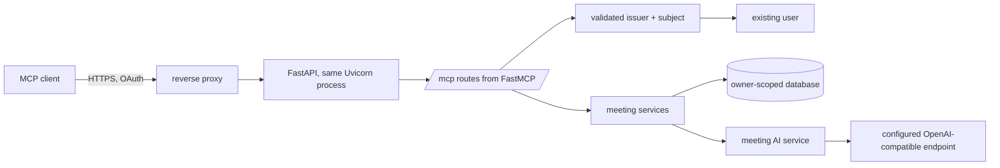

# AI services and MCP design

How the typed meeting AI calls and the remote MCP endpoint are built, and the boundaries they keep. For operator setup read [Configuration › Remote MCP endpoint](../configuration.md#remote-mcp-endpoint); for the user's side read [Connect your AI app](../mcp.md).

## Outcome

A self-hosted operator can deliberately enable a remote `/mcp` endpoint for Claude Code and other MCP clients. A user signs in with the configured identity provider in the browser, then can read and ask questions about only their own meetings. The API has one small typed AI-service seam for meeting questions and persisted meeting summaries, without becoming an agent platform.

## Safe defaults

| Concern | Decision |
| --- | --- |
| Availability | `MCP_ENABLED` defaults to false. When false, `/mcp` and its metadata routes are not mounted. When true, authentication is mandatory; there is no anonymous mode. |
| Local mode | No MCP endpoint or metadata routes in device mode. The `serve-local` profile never mounts it. |
| Authentication | A FastMCP OIDC proxy in front of the configured identity provider, with its own client registration (`MCP_OIDC_CLIENT_ID`). Desktop session tokens, browser sessions and the local boot token are never reused. |
| Identity | Validate the token's issuer, signature, expiry, audience and scope, then resolve the existing user by exact issuer and subject. Never link by email. A session identifier is never identity. |
| Scopes | `meetings:read` permits listing and reading saved meeting text. `meetings:ask` permits bounded language-model questions. There is no write scope and no mutating tool. |
| Transport | Streamable HTTP at one public `https://…/mcp` endpoint, stateless, with host and origin protection explicitly enabled. |
| Tools | Read-only, owner-scoped tools that call domain services directly, never loop back through the API's HTTP routes and never auto-expose FastAPI routes. |
| AI abstraction | One injected meeting-AI service: no tools, subagents, history, autonomous loops, web access or external observability. |
| Tests | Repository-owned synthetic fixtures and deterministic fake models only. No hosted tracing, prompt logging or provider calls in tests. |

## Composition

The OIDC proxy is inside the server boundary. It sends the user to the upstream identity provider to sign in, issues MCP-specific access tokens, and keeps upstream credentials server-side in encrypted storage under `MCP_STORAGE_DIR`, signed and encrypted with `MCP_SIGNING_KEY`. Neither the tool layer nor the MCP client ever receives upstream tokens, gateway credentials, API session tokens or device boot tokens.

## Meeting AI service

`meeting_ai.py` builds a Pydantic AI agent against the selected `LLM_BASE_URL` and `LLM_API_KEY`, or the gateway fallback, using the `pydantic-ai-slim[openai]` package.

- **Questions.** The answer path receives an immutable, owner-resolved snapshot of the complete saved transcript and summary; callers never submit authoritative meeting text. The full text is sent without silent truncation, and a context-length rejection returns a clear error rather than shortening the input. Answers are never persisted.
- **Summaries.** `summarize(transcript)` is the summarizer `MeetingService` uses on the exact durable worker snapshot. The worker keeps its lease, source revision and conditional completion rules, so a late summary never overwrites a user's edit.
- **Boundaries.** A fixed system instruction treats transcript, summary and question as untrusted data inside explicit delimiters. Each operation makes one model request with no tools, history or semantic retries, caps output at 2048 tokens, and rejects empty or oversized output. Errors and logs never echo meeting text.

## Tool surface

| Tool | Arguments | Result and limits | Scope |
| --- | --- | --- | --- |
| `list_meetings` | opaque `cursor`, `limit` 1–20 | Owner-only metadata page with a next cursor. No transcript text or audio. | `meetings:read` |
| `get_meeting_text` | `meeting_id`, `part` (`transcript` or `summary`), opaque text `cursor`, `max_characters` 1–16,000 | An exact page of the current saved text with its revision, status and staleness, plus a next cursor. Never drops text silently and never returns audio. | `meetings:read` |
| `ask_meeting` | `meeting_id`, `question` up to 2,000 characters, optional `transcript_revision` and `summary_revision` | An ephemeral bounded answer from the complete saved snapshot, plus the revisions used and summary freshness. | `meetings:ask` |

There is no summarize or regenerate tool, because regeneration changes durable state and is not read-only. Any future write tool needs its own scope, precondition and idempotency policy, and a user-facing consent decision. Every lookup is owner scoped, and "not found" never reveals another user's record.

## OAuth and deployment

- Protected-resource metadata (RFC 9728) and authorization-server metadata (RFC 8414) are served at root-level well-known routes. The advertised resource is exactly the public HTTPS `/mcp` URL, from `MCP_PUBLIC_URL` or `PUBLIC_URL`.
- Tokens with the wrong issuer, signature, expiry or audience, and ID tokens, are rejected with 401.
- The reverse proxy terminates TLS, preserves the MCP headers, disables response buffering and sets read and send timeouts of at least `MEETING_GATEWAY_TIMEOUT_SECONDS`. Only the configured `MCP_ALLOWED_HOSTS` and `MCP_ALLOWED_ORIGINS` are accepted, and an invalid `Origin` gets 403.
- Claude Code connects as a remote HTTP MCP server and signs in through its interactive `/mcp` OAuth flow.

## Non-goals

No multi-agent system, autonomous work, tool execution by the meeting AI, retrieval or vector store, prompt history, MCP access to notes, dictionary, audio or metrics, streaming answer persistence, telemetry or tracing SDK, OAuth server written in this repository, or MCP in device mode.

## Implementation notes

These are where the shipped code differs from the original proposal:

- **Mounting.** FastMCP's app is built with `http_app(path="/mcp")` and each of its routes is copied into the parent application as a plain Starlette route, rather than mounting a sub-application at `/mcp`. The public URL is the same, and nothing MCP appears in `openapi.json`. Its lifespan runs inside the API lifespan and exits before the worker and HTTP clients close.
- **Plain-text agent.** The agent is `Agent[None, str]` with no dependencies object and no structured-output mode. The text is wrapped into `MeetingAnswer` and `MeetingSummary` models afterwards, which avoids depending on each gateway's structured-output support.
- **Argument names.** Tool arguments are snake_case: `max_characters`, `transcript_revision` and `summary_revision`.
- **Missing scope.** The proxy requires `meetings:read` on every token, so a token without it is rejected at the HTTP layer. A token without `meetings:ask` reaches the tool, and `ask_meeting` returns a tool error instead of an HTTP 403.
- **Package.** The dependency is `fastmcp-slim[server]` 4.1.0, the server-only build of standalone FastMCP. The separate `mcp` SDK comes in only as its dependency.
- **Settings.** Beyond `MCP_ENABLED`, the endpoint uses `MCP_PUBLIC_URL`, `MCP_OIDC_CLIENT_ID`, `MCP_OIDC_CLIENT_SECRET`, `MCP_SIGNING_KEY`, `MCP_STORAGE_DIR`, `MCP_ALLOWED_HOSTS`, `MCP_ALLOWED_ORIGINS` and `MCP_ACCESS_TOKEN_MINUTES`, all described in [Configuration](../configuration.md). The desktop's Settings › MCP section shows the connection URL and copyable client setup.

Headless and copy-paste OAuth flows and every identity provider are not yet verified; see the [roadmap](../roadmap.md#mcp).
