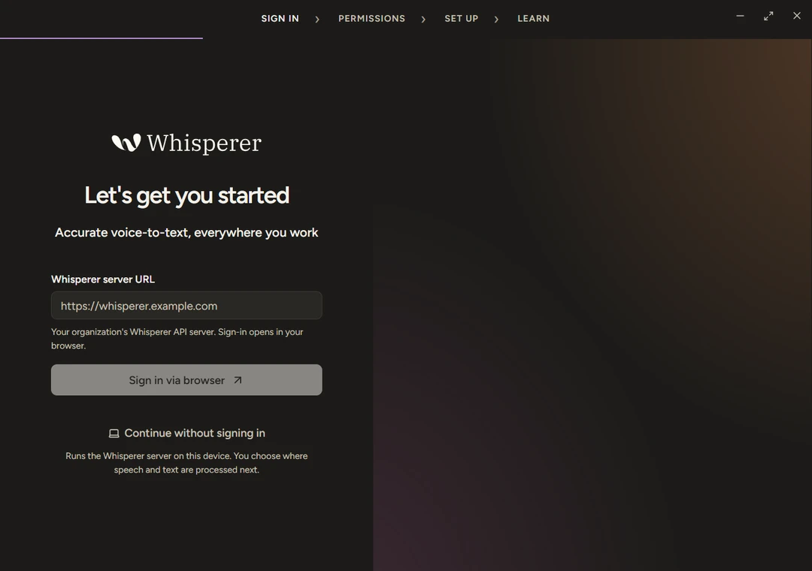
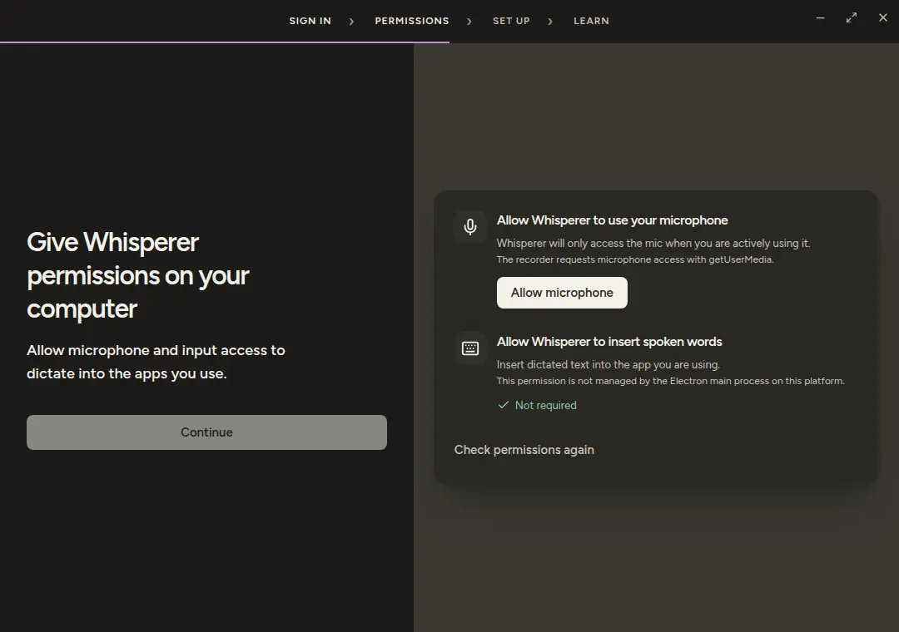
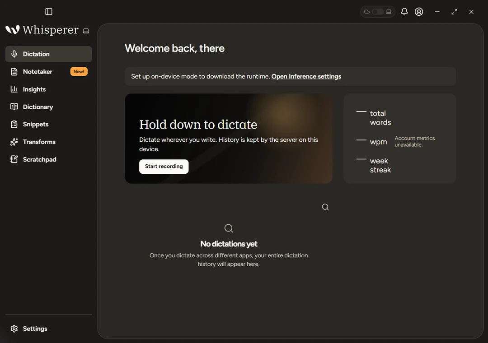
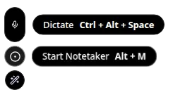
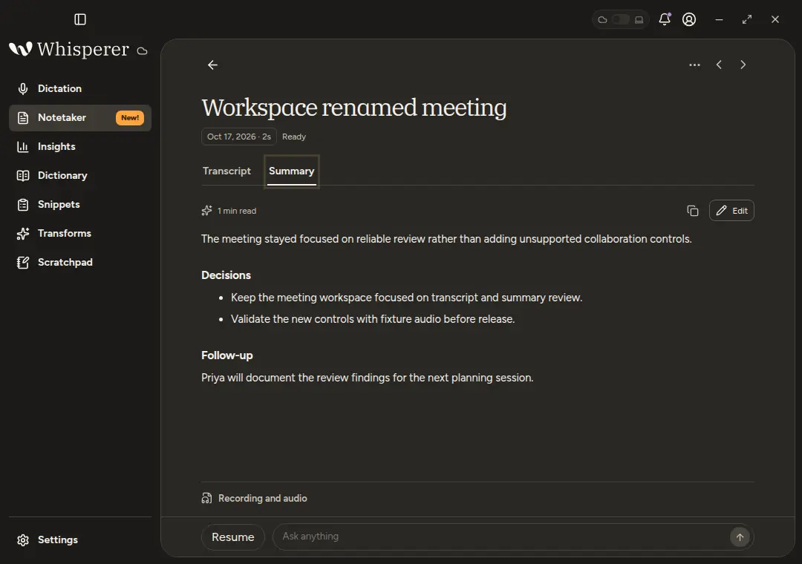
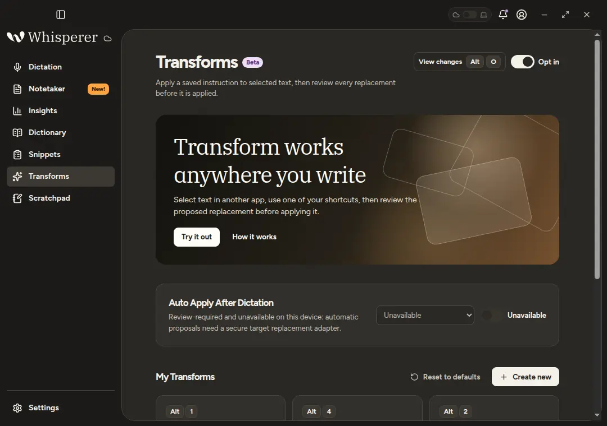

# Get started

## From the installer to your first dictation

Whisperer works in two modes. Local mode runs everything on your computer with no account. Remote mode connects to a server you or your team host. You pick on the first screen and can switch later.

## Install

Download the installer for your platform from the [releases page](https://github.com/sharukeshalagiri/Whisperer/releases) and run it.

| Platform | Installer | Notes |
| --- | --- | --- |
| macOS | `Whisperer-<version>-mac-arm64.dmg` or `-mac-x64.dmg` | Builds are unsigned. Open the app once from the context menu to pass Gatekeeper, and grant Accessibility when asked. |
| Windows | `Whisperer-<version>-win-x64.exe` | Unsigned NSIS installer. SmartScreen asks once. |
| Linux | `Whisperer-<version>-linux-amd64.deb` | X11 insertion needs `xdotool`. On Wayland, completed dictations go to the clipboard. |

Updates are not installed by the app. It checks the release feed after launch and every six hours, and the bell offers the download when a newer build exists. Run the new installer over the old one and your data stays in place.

## Choose a mode

- **Local mode.** Press `Continue without signing in`. Whisperer runs its own server on this computer, and the next step downloads the runtime and a speech model. Nothing leaves the machine unless you point it at an HTTP endpoint. [Local mode](local-mode.md) covers what is downloaded and what stays local.
- **Remote mode.** Enter the URL of your Whisperer server, such as `https://whisperer.example.com`, and press `Sign in via browser`. The browser opens your identity provider. After you sign in there, the browser shows a code: approve only if it matches the code Whisperer shows, and the app signs in when you return. A sign-in link that someone else sent you cannot complete, because no Whisperer on your computer shows its code. The URL is saved only after sign in completes and is cleared when you sign out. Remote servers must use HTTPS. A server on this computer may use `http://127.0.0.1:14318`.
- **Either way,** a `Cloud` or `Laptop` mark beside the logo names the active backend. Settings › Account switches between them, and the switch waits for a running dictation, meeting or transform to finish.

## Set up this device

Onboarding configures the computer in front of you and nothing else.

1. **Permissions.** Allow the microphone. macOS also asks for Accessibility, which the paste keystroke and the global shortcuts need, and for Automation. A rebuilt unsigned app gets a new Accessibility record, so a stale grant may show as on and still be ignored. The checklist offers to reset it.
2. **Microphone.** Pick an input and watch the meter move.
3. **Language.** English, Spanish, French, German or Portuguese.
4. **Shortcut.** Test the hold to talk and hands free chords. Defaults are `Control+Alt` to hold and `Control+Alt+Space` to toggle, with `Control+Super` on Windows. The Fn key cannot be captured, so `Option+Space` is the usual choice on a Mac.
5. **Tutorial.** Dictate a sentence into the practice field.

## Dictate

Hold the shortcut, speak, and release. The text is polished by the language model and pasted at the cursor of the app you were using. Whisperer pastes through the clipboard and then puts back the text you had copied. When it cannot paste, the dictation stays on the clipboard instead. Dictation history stays on this device and is listed on the home screen by day, with copy and delete on hover and a search.

- **Dictionary** holds the names and terms the model should spell your way. Entries belong to your account and apply once to each dictation. Meetings and transforms never use them.
- **Snippets** expand a spoken trigger into saved text when a dictation completes.
- **Scratchpad** is a small editor for text that has no home yet. `Alt+S` opens it.
- **Insights** shows total words, words per minute and your streak. The server keeps only the numbers.

### The pill

A small bar stays at the edge of the screen while Whisperer runs. It shows the level meter while you speak and a cancel button while a request is processing. Hovering reveals Start Notetaker and your first transform with their shortcuts. Drag it to the bottom or to either side, where it turns to stack along the edge.

### Shortcuts

Settings › General › Shortcuts lists every action with up to four chords each. The recorder captures a chord as you press it, refuses one that collides with another action and shows the double tap that starts hands free mode.

| Action | macOS | Windows | Linux |
| --- | --- | --- | --- |
| Hold to talk | `Control+Alt` | `Control+Super` | `Control+Alt` |
| Hands free toggle | `Control+Alt+Space` | `Control+Super+Space` | `Control+Alt+Space` |
| Paste last transcript | `Control+Command+V` | `Alt+Shift+Z` | `Alt+Shift+Z` |
| Copy last transcript | `Control+Command+C` | `Alt+Shift+X` | `Alt+Shift+X` |
| Scratchpad | `Alt+S` | `Alt+S` | `Alt+S` |
| Start Notetaker | `Alt+M` | `Alt+M` | `Alt+M` |
| First transform | `Alt+1` | `Super+Alt+1` | `Alt+1` |
| View changes | `Alt+O` | `Super+Alt+O` | `Alt+O` |
| Cancel | `Escape` | `Escape` | `Escape` |

Global shortcuts are opt in and use a native key hook. Wayland sessions and mouse buttons are not supported.

## Notetaker

Press `Alt+M` or the pill's Notetaker button to record a meeting from the microphone. Stop it and the server transcribes each segment and writes a summary. One recording session holds up to about two hours. At that point Whisperer finishes the meeting by itself and keeps everything recorded; press Resume to continue in a new segment. Imported audio files can be up to 25 MB. Both are yours to edit, and Resume appends a new segment without touching what you changed. Ask anything at the bottom sends one question with the complete saved transcript and summary to the model and shows the answer without saving it.

Meetings belong to your account on the server. Recorded and imported audio is uploaded there for transcription and kept until you delete the meeting, and a copy stays on the computer that recorded it for playback. In Local mode the audio stays on this computer, unless you point speech at an HTTP endpoint. Summary regeneration never overwrites an edit made in the meantime.

## Transforms

Opt in on the Transforms screen, then select text in any app and press a transform's shortcut. Whisperer uses the selection, or the whole field when nothing is selected, sends it with the saved instruction and pastes the result in place only if the same text is still selected. A pop up above the pill shows the before and after, and `View changes` reopens it. Polish is the first transform. Create your own with an instruction and a chord.

Automatic rewriting after a dictation is shown but disabled, and it says so. It needs a safe way to replace text in the app you are writing in, which does not exist yet.

## Settings

| Section | What it holds |
| --- | --- |
| General | Shortcuts, microphone, languages and whether dictation is polished by the language model. |
| System | Appearance, open at login, the pill, automatic paste, the Scratchpad button and the update check. |
| Notetaker | Where captured meeting audio is kept. It stays on this device until you delete the meeting. |
| Inference | Local mode only. The runtime, the speech model and the optional language model endpoint. |
| MCP | The connection URL and setup for AI apps. See [Connect your AI app](mcp.md). |
| Account | The connected server or the on-device state, and the switch between them. |
| Data and Privacy | Where audio and text go, `Sync now`, the sync at start toggle and Delete on-device data. |

## Next steps

- [Local mode](local-mode.md), the runtime, the model catalog and sync.
- [Self hosting](installation.md), running a server for a team.
- [Connect your AI app](mcp.md), reading meetings from Claude Code and friends.
