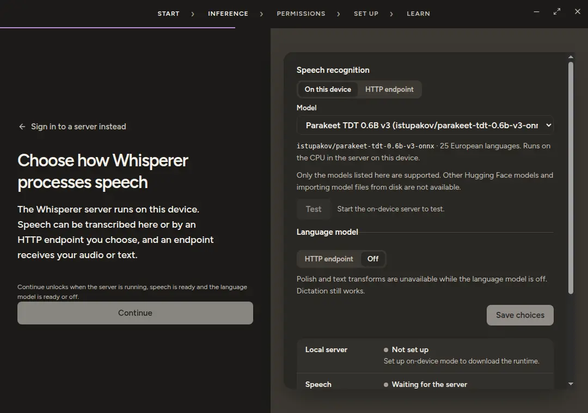

# Local mode

## Everything on your own computer

Local mode runs Whisperer entirely on your computer, transcription included. It needs no account and no server. With speech on this device and a language model you run yourself, such as Ollama, dictation needs no network connection after setup, but any HTTP endpoint you configure receives your audio or text, even on localhost. Behind the scenes the desktop starts the same server a team would host, reachable only from this computer. Your dictionary, notes, meetings and metrics live in a local database in the app's data directory and stay separate from any server account until you sync.

Choose `Continue without signing in` on the sign in screen, or Settings › Account › `Use this device instead` when you are already signed in. The `Laptop` mark beside the logo confirms the switch.

## What gets downloaded

The installer is small. It carries the API source and its lock file and nothing else. The runtime and the models download only when you press `Set up on-device mode` or `Download model`, and the screen shows progress for each stage. Nothing downloads at install, at startup or in the background.

1. **Runtime.** The desktop downloads `uv` 0.13.1, checks its size and SHA-256, installs Python 3.12.15 with it and installs the locked API packages with the `local` extra. Allow about 2 GiB of free disk. A Linux x64 run measured about 300 MB of uv cache and about 100 MB of Python before the packages.
2. **Speech model.** Pick one of two verified models. The API downloads pinned files over HTTPS and checks the size and SHA-256 of each one before it uses them. Only these two can be installed. Custom repositories and import from disk are not offered.
3. **Language model.** Polish, transforms, note summaries and meeting questions need a language model, which Local mode does not include. Point it at an OpenAI compatible HTTP endpoint, such as Ollama on `http://127.0.0.1:11434/v1`, or leave it off. Ollama on the same computer keeps the whole setup offline. With it off, dictation returns your words unpolished and the other features report that the language model is off.

| Model | Download | Languages |
| --- | --- | --- |
| `istupakov/parakeet-tdt-0.6b-v3-onnx` | about 670 MB | 25 European languages |
| `istupakov/whisper-base-onnx` | about 108 MB | Multilingual |

Speech can use an HTTP endpoint instead of a downloaded model, in the same Inference section.

## Where your audio and text go

Local mode is not a promise of zero network traffic. It is a promise that you can see every path.

- **Local model.** Speech recognition runs on your CPU and the audio never leaves the process.
- **HTTP endpoint.** The endpoint receives your audio or your text. Whether that leaves your device depends on the endpoint you configured. A `localhost` address alone does not prove it is not forwarded onward.
- **Downloads.** The runtime and the models use the network when you start them.
- **Secrets.** Endpoint keys travel to the child on its stdin and are stored encrypted by the operating system. They never appear in arguments, environment, files or logs.

Data and Privacy names the current destination of audio and text, and this page cannot say it better than that screen does for your configuration.

## Keep this device and a server in step

Sign in to a server once, then switch to this device. Data and Privacy › `Sync now` exchanges snapshots both ways between the local server and the remote account.

- Notes, dictionary entries, the text of finished meetings and dictation statistics move in both directions.
- The newer edit of each record wins, and deletions carry over so a later sync does not bring them back.
- Recordings stay on the machine that made them. A meeting copied to the other side has text but no playback.
- A meeting still being transcribed waits for the next sync.
- Dictation history and snippets are not synced.

Turn on `Sync automatically when the on-device server starts` to run the same sync at each start of Local mode. A sync blocks a backend switch and an erase until it finishes. Each server's clock decides which edit is newer, so a badly skewed clock can let an older edit win, and two edits to the same note keep only the newer one.

## Erase everything on this device

Data and Privacy › `Delete on-device data` asks you to type DELETE. It then removes the local server's rows, the meeting audio and the free pages of both SQLite files. The runtime, the models and your settings stay, and the next request starts a fresh empty device user. Filesystem snapshots and backups outside the app are not touched.

## Limits

- Only the Linux x64 install has been exercised end to end. The same install is expected to work on macOS, Windows and Linux arm64 and has not been verified there.
- Inference runs on the CPU. There is no GPU support. One Parakeet dictation clip measured about 3.3 s on a Linux x64 CPU.
- Inference is serialized. A long meeting segment delays a dictation that arrives while it is processed.
- Cancelling a model download stops the local server. Starting it again begins the download over.
- The MCP endpoint is never offered in Local mode.
- Switching to a server and back keeps each side's data. A switch is refused while a dictation, meeting or transform is running.

The full list of open issues is on the [roadmap](roadmap.md). The boot protocol between the desktop and its child is specified in the [developer reference](api-runtime.md#on-device-server).
