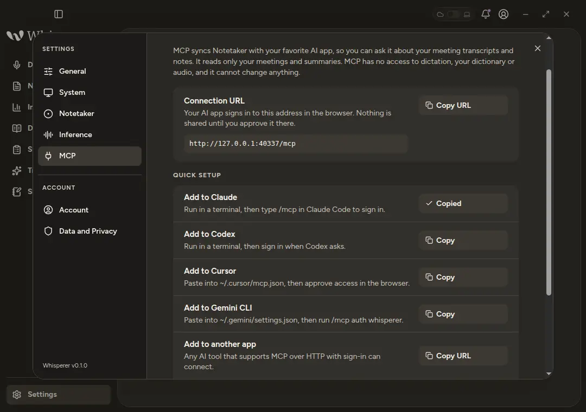

# Connect your AI app

## Read your meetings from Claude Code, Codex, Cursor or Gemini CLI

Whisperer includes an MCP server, so your AI tools can work with your meetings. Ask Claude Code what was decided last week, or pull a summary into Cursor while you write the follow up. Access is read only and limited to your own meetings, and you approve it in the browser before anything is shared.

## What the endpoint can and cannot do

- **It reads meetings.** `list_meetings` returns titles, times, durations and processing states with no text, 20 per page. `get_meeting_text` returns saved transcript or summary text in pages of at most 16,000 characters. `ask_meeting` sends the complete saved transcript and summary with one question of at most 2,000 characters to the server's language model and returns the answer.
- **It sees nothing else.** Dictation, your dictionary, notes, metrics and audio are never exposed. Another user's meeting is reported as not found.
- **It writes nothing.** No tool edits, regenerates, deletes or creates a meeting, and neither the question nor the answer is saved.
- **Everything it returns goes to your AI app** and to the model behind it. Treat a transcript you read through MCP as shared with that app.
- **It is a server feature.** Local mode never offers it, and the operator of a server has to turn it on. If Settings › MCP says the endpoint is unavailable, ask the operator or see [the configuration page](configuration.md#remote-mcp-endpoint).

## Set it up

Open Settings › MCP. The connection URL is your server address followed by `/mcp`. Each quick setup row copies a ready to use command or configuration fragment, and the app never runs or opens them itself.

| App | What to do with the copied text |
| --- | --- |
| Claude Code | Run `claude mcp add --transport http whisperer <url>` in a terminal, then type `/mcp` in Claude Code to sign in. |
| Codex | Run `codex mcp add whisperer --url <url>` in a terminal and sign in when Codex asks. |
| Cursor | Paste the fragment into `~/.cursor/mcp.json`, then approve access in the browser. |
| Gemini CLI | Paste the fragment into `~/.gemini/settings.json`, then run `/mcp auth whisperer`. |
| Another app | Add a custom connector with the URL. Any app that supports MCP over HTTP with sign in can connect. |

Sign in happens in the browser against the same identity provider as the desktop. The app receives an access token that lasts an hour by default, and it asks you to sign in again when that runs out. Nothing is shared until you approve the consent page.

## Limits

- Each `ask_meeting` call is one language model request and counts like a question asked in the desktop. The server bounds it with the meeting timeout.
- Questions are single turn. There is no conversation history, streaming or citation.
- Answer quality has only been checked with synthetic fixtures, and the full browser sign in has not yet been exercised against a production identity provider.
