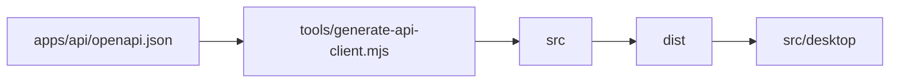

# packages/api-client

Generated TypeScript source and CommonJS API client output.

## How it works

Run `make api-contract` to regenerate source and compiled output from the committed schema.

## Used by

`src/desktop` loads `dist` through CommonJS.

## Structure

`src` is generator output and `dist` is its compiled counterpart.

This package is the generated CommonJS client for the committed API OpenAPI document.

Run `make api-contract` from the repository root after changing the API. That command exports the schema, runs the generator, compiles TypeScript, and verifies that both contract and client are committed.

| Path | Responsibility |
| --- | --- |
| `src/` | Generator output in TypeScript. |
| `dist/` | Compiled CommonJS output loaded by Electron. |
| `tsconfig.json` | Compiles the generated source to CommonJS. |

[tools](../../tools/README.md) owns the generation command. [src/desktop](../../src/desktop/README.md) is the external caller.
