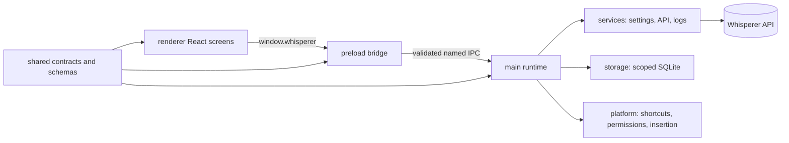
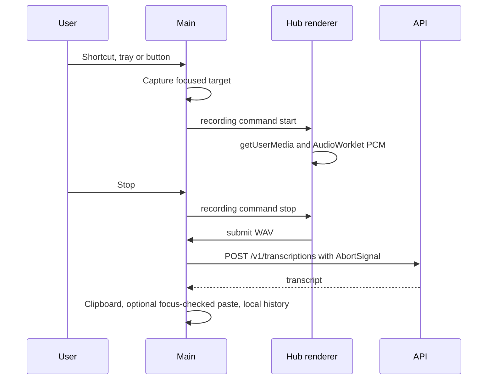

# src/desktop

The Whisperer Electron application for macOS, Windows and Ubuntu.

## How it works

`make desktop` builds with electron-vite and starts Electron. `make desktop-test`, `make desktop-lint` and `node tools/drive-desktop.mjs` check it. `make linux`, `make windows` and `make dmg` package it with fuses applied.

The main process owns credentials, local SQLite data, the API transport, native platform adapters and window lifecycle. Every window is sandboxed and context isolated. Pages load only from the packaged `whisperer://local` protocol under a strict Content-Security-Policy, and renderer network requests are cancelled. The renderer reaches main only through named `window.whisperer` methods whose payloads are validated with Zod in both directions.

## Used by

Electron loads `out/main/index.js`. Users reach their own Whisperer API by entering its URL at sign-in. The operating system delivers `whisperer://` return links, which only shorten verifier-protected polling.

## Structure

A dictation runs as follows.

| Path | Responsibility |
| --- | --- |
| [main/](main/README.md) | Electron lifecycle, windows, IPC handlers and composition. |
| preload/ | Sandboxed bridge exposing named desktop methods. |
| renderer/ | React screens, recording capture and styling. |
| shared/ | Process-neutral IPC contract and runtime schemas. |
| assets/ | Desktop icons, logo and fonts. |
