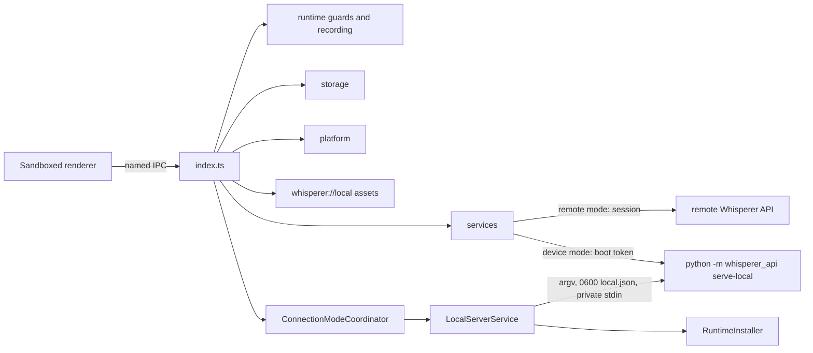

# Desktop main process

The Electron main process. It owns windows, the packaged `whisperer://local` protocol, Electron security controls, named IPC handlers, credentials, local data and native integrations.

## How it works

`index.ts` composes services, storage and platform adapters, then registers each IPC channel from `shared/protocol.ts` with sender-frame and Zod payload validation. The hub, scratchpad and overlay windows are sandboxed, context isolated and blocked from navigation and popups. Renderer network requests are cancelled; only the dedicated API session talks to the server. Local logs are redacted and bounded. Backend-owned meeting content and dictionary entries are cached per account. `meetings.ask` passes only the requested meeting ID, question, and optional revision expectations through that session; it persists nothing and rejects a late answer after an account or backend scope change. Stable pending segment IDs and numerical metric events survive restarts, and no delayed result can mutate a different signed-in account. Transform definitions and review sessions cross the same named IPC boundary; source selection, target identity and accepted replacement remain main-held, and replacement is conditional on unchanged selection and focused owned review UI. The recording pill is a small, non-focusable, always-on-top window sized from its visible state plus hit padding. Only that overlay may report hover or drag; main reads the cursor, follows the active display, persists only the dock edge in `recording-pill.json`, publishes that edge so the pill can turn vertical on a side, grows the hovered window toward the screen interior for tooltips, and relays hub-only meter values without storage. The pill may also start Notetaker through the overlay-only `overlay.startNotetaker` channel.

Exactly one backend is active, chosen by the persisted `connectionMode`. In `remote` mode the API session talks to the signed-in server. In `device` mode main supervises its own Whisperer API child on loopback, the hub runs without sign-in as the fixed account `device`, and local data lives in a store scope no remote account shares. A retained remote session stays saved but unused. Switching is refused while dictation, a meeting or a shortcut transform is in flight. It invalidates in-flight results and leaves each backend's caches and queued uploads in their own scope, so nothing crosses backends or accounts. Remote mode never starts the local server. Quitting stops the server before exit, and if main dies instead, the server exits when its stdin closes.

## Used by

Electron starts `out/main/index.js`. The operating system delivers deep links, tray clicks and global shortcuts. The macOS menu bar item uses a template icon and offers Open Whisperer, Paste last transcript and Quit Whisperer. macOS reports no event when Accessibility trust changes, so main polls it and re-registers native shortcuts when it flips. Renderers reach this process only through the preload bridge.

## Structure

| Path | Responsibility |
| --- | --- |
| [runtime/](runtime/README.md) | Sender guard, asset containment, recording cancellation, recording-pill geometry, backend switching and the on-device server. |
| services/ | Settings, API transport and logs. |
| storage/ | Account-scoped local SQLite. |
| [platform/](platform/README.md) | Permissions, shortcuts, target capture and insertion. |

`localData.erase` runs only in device mode, when nothing is recording, capturing, transforming or switching. It calls the on-device server's `DELETE /v1/local/data` first and only on success erases the device scope in `LocalStore` and its private meeting audio, then bumps the meeting scope epoch so late sync results cannot write back. New recordings and meetings are refused while it runs. Remote account data, the runtime, models and settings are never touched.

`dataSync.run` runs only in device mode with a verified local server, a signed-in remote session and nothing recording, capturing, transforming, switching or erasing. `DataSyncCoordinator` exchanges `/v1/sync` snapshots through `ApiService` on both sides, then main flushes pending meeting delivery and tells the hub to reload notes, meetings and history. With the opt-in `syncAtStartup` preference, the same sync runs each time the on-device server becomes ready. A sync in progress counts as busy, so a backend switch or an erase waits for it.

`publicSettings()` also carries `runtimeInstalled`, cached from `LocalServerService.runtimeInstalled()` at startup and after each server state change, so the renderer can enable the cloud/device toggle without starting or downloading anything.
