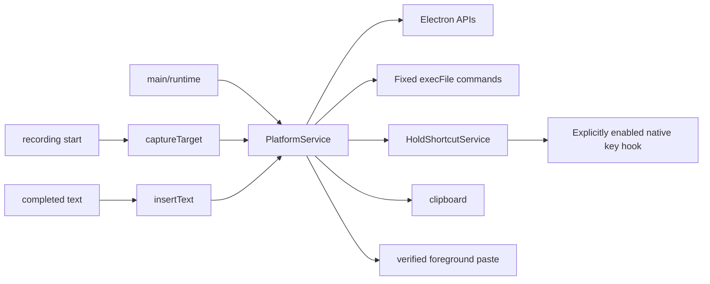

# Native platform adapters

This directory owns main-process adapters for operating-system permission status, foreground-target capture, clipboard-backed insertion, global shortcut registration, and permission settings navigation. It does not own IPC, recording lifecycle, renderer permission prompts, or server calls.

## How it works

`PlatformService` receives Electron APIs and a fixed-command `execFile`-compatible runner through dependency injection. It never accepts a renderer command, executable path, or shell fragment. A caller captures a target before recording, then calls `insertText` only for completed, non-cancelled text. Transform orchestration may retain that opaque main-process target, capture a verified selection, and replace it only if it remains unchanged.

The service retains completed text on the clipboard after an insertion attempt, matching the existing copy-result behavior. It leaves the clipboard untouched when a target is absent, invalid, changed before insertion, or the platform is unsupported. Selection capture stages a unique clipboard sentinel before copying and restores the prior clipboard; acceptance restores the original target only when a captured main-owned review window is still foreground, then rechecks its exact selection.

- Windows records HWND and owner PID through a fixed PowerShell program and compares both in the final paste program.
- macOS records the frontmost application's bundle ID and process ID through fixed AppleScript. It inserts only when both still match. System Events windows expose no stable ID, so a window-level check would reject every target.
- Linux supports X11 only when `xdotool` is installed. It rechecks focus before input, then directs copy and paste to the captured X11 window rather than mutable foreground focus. Wayland reports unsupported because no consent-based adapter is present.
- System audio reports unavailable. `HoldShortcutService` starts `uiohook-napi` only for a signed-in session and recognizes only configured action chords, including modifier-only chords. It keeps transient pressed key codes in memory to recognize exact chords, never logs or forwards them, and removes callbacks during recorder capture, sign-out or quit. Electron `globalShortcut` is the press-only fallback for actions with a non-modifier key; push to talk and modifier-only chords remain unavailable there. Fn and mouse buttons are not observable through this adapter. Wayland remains unavailable; macOS also requires Accessibility trust.
- macOS consent is checked before input. Each ad-hoc build has a new code hash, and macOS silently ignores an Accessibility grant recorded for an older hash even though System Settings still shows it on. Requesting Accessibility therefore resets only this app's record with a fixed `tccutil reset Accessibility <bundle id>`, prompts again and opens the Accessibility page. Automation for System Events is probed with a read-only AppleScript; a recorded denial (error -1743) is reported instead of a missing target.
- `selectAll` sends Cmd/Ctrl+A to the captured target only while it is still focused. `replaceCapturedSelection` re-copies the selection and pastes a transform result only when it still equals the captured source. Copy capture waits up to 750 ms, because browsers and Electron apps can be slow to publish the clipboard.
- `pressEnter` sends Return through the same fixed adapters as paste: PowerShell SendKeys, System Events key code 36 or X11 `xdotool`.
- Linux and Windows microphone consent belongs to the recorder's user-triggered `getUserMedia`; macOS uses `systemPreferences.askForMediaAccess`.



## Used by

Only `main/index.ts` uses this directory, during recording start, completion, permission requests and shortcut registration.

## Structure

`PlatformService.ts` holds all adapters behind one class. Its tests inject command runners and Electron fakes.

## Integration

The main-process composition root constructs one `PlatformService` with `platform`, `process.env`, `clipboard`, `globalShortcut`, `systemPreferences`, `shell`, and an `execFile` promise wrapper. Store `CaptureTarget | null` only in main-process recording state. Call:

```ts
const target = await platformService.captureTarget()
const result = await platformService.insertText(text, target)
const status = await platformService.capabilityStatus()
```

Pass `status` directly as the shared `Capabilities` contract. Surface `result.reason` directly to the UI or logs without target IDs or command output.

## Files

| Path | Role |
| --- | --- |
| `PlatformService.ts` | Typed adapter and exported main-process API. |
| `HoldShortcutService.ts` | Lazy, injected, privacy-bounded press-and-hold native trigger. |
| `PlatformService.test.cjs` | Injected-adapter unit tests. |
| `HoldShortcutService.test.cjs` | Hold trigger parsing, lifecycle, and session-support tests. |
