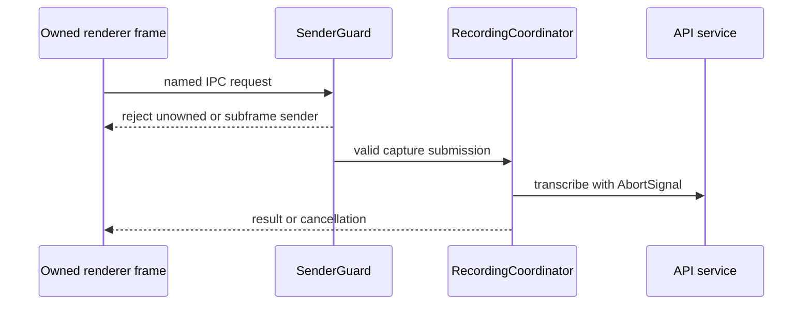
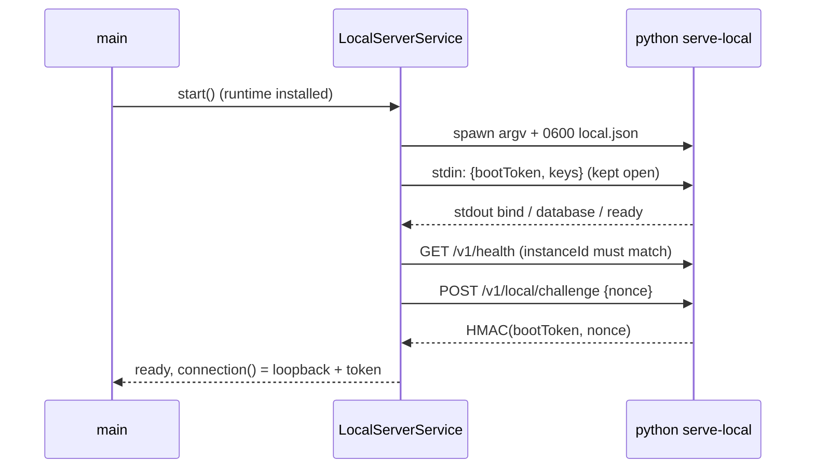

# Main-process runtime controls

Small, Electron-free coordination components for security-sensitive main-process decisions.

## How it works

`SenderGuard` accepts only the main frame of a runtime-owned window. `LocalAssetResolver` maps `whisperer://local` URLs to real paths contained in the packaged renderer directory and returns their content type. `RecordingCoordinator` reserves one start-target lookup or transcription at a time, passes cancellation to the API and rejects late completions before a start command or result is published. `ShortcutRuntimeService` turns native press and release into dictation: hold starts push to talk and release submits, a press under 500 ms cancels, a quick second press locks hands-free, and a third quick press opens Notetaker after onboarding. Before onboarding completes only push to talk, hands-free and cancel run; recorder capture suspends every action. `TransformCoordinator` captures selected text and its opaque native target before the hub changes focus, holds generation and replacement state in main memory, aborts superseded generation, and asks the platform adapter to conditionally replace only an unchanged selection. Its `run` method serves transform shortcuts: it captures the selection, selects the whole field when nothing is selected, generates the replacement and pastes it over the same still-selected text, reporting applying, applied or failed so main can drive the pill and the result pop-up. The review-session methods remain for explicit review surfaces. `OverlayGeometry` docks the compact recording pill to the bottom, left or right of a display work area, grows the hovered window toward the screen interior without moving the bar, chooses the nearest edge after a drag and clamps live dragging inside that display. Only the edge is persisted, so a stale monitor coordinate cannot restore offscreen.

### On-device server

`RuntimeInstaller` runs only from an explicit Set up click. It provisions an isolated runtime under `<userData>/runtime` in three stages: `uv`, `python` and `packages`.

1. It downloads the pinned uv archive for this OS and architecture from `runtime-manifest.json` over HTTPS and checks its exact size and SHA-256. The digests are copied from the upstream GitHub release assets. It then extracts only the `uv` binary and atomically renames it into place.
2. `uv python install <pinned>` installs a uv-managed CPython.
3. `uv sync --locked --no-dev --no-build --no-install-workspace --package whisperer-api --extra local --managed-python --no-python-downloads` builds a temporary venv from the bundled read-only project and renames it into `envs/<key>` with a marker file.

Every command is an argument array with no shell, and uv inherits only allowlisted environment entries (OS basics, locale, proxies). uv trusts system certificates. `--no-build` refuses source distributions, so nothing compiles. The key hashes the pinned versions, platform and lock inputs, and older environments are removed once a new one completes. Concurrent installs share one attempt. A cancelled or failed install leaves the previous complete runtime intact, and each failure names its stage.

`LocalServerService` launches `<venv python> -B -E -s -m whisperer_api serve-local --config <0600 local.json>` from the bundled `apps/api/src`. It passes the allowlisted environment and no secrets in argv, environment or files. It writes one private JSON line with a fresh 32-byte boot token and the decrypted provider keys to stdin, and keeps stdin open so the server exits when main goes away. Stdout events are parsed line by line, and lines over 4 KB are dropped. stderr becomes the activity log, redacted of tokens and keys and capped at 100 lines.

A port is trusted only after `/v1/health` reports the `instanceId` main wrote and `/v1/local/challenge` returns the HMAC-SHA256 of a fresh nonce under the boot token. Until then no bearer token is sent. A crash after ready restarts automatically at most twice, then reports "Local server stopped unexpectedly" until the user restarts. Startup is bounded by a timeout. Stop closes stdin, then sends SIGTERM and SIGKILL only to the owned child.

`ConnectionModeCoordinator` serializes backend switches. It refuses a switch while work is in flight and detaches the old scope first. Before routing to a remote server it cancels any install and stops the local server. After entering device mode it starts an installed local server in the background without downloading. `LocalServerService` checks `shouldRun()`, so an install that finishes after the user leaves device mode never launches a server. A download that sends no bytes for 60 s fails as stalled.

`DataSyncCoordinator` keeps the on-device and the signed-in remote server in step. It exports both snapshots before merging either, so each merge sees the other side's state from before the exchange, and the API's last-writer-wins merge makes both converge. Concurrent callers share the run in flight, and a refused or failed run leaves the next one free to retry.

## Used by

`main/index.ts` composes these modules with Electron. Their tests run without Electron.

## Structure

No module here exposes a generic renderer invocation surface.
