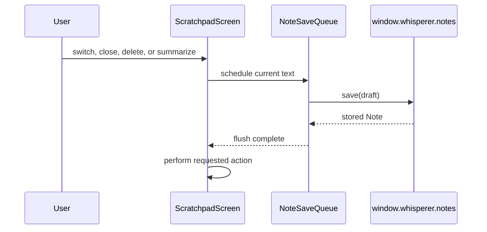
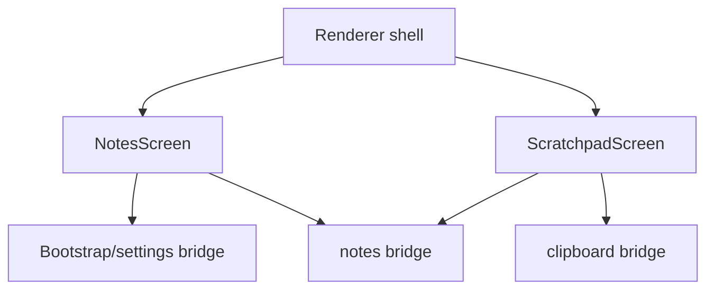
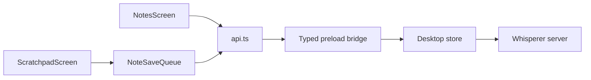

# Content screens

React screens for server-synchronized notes, device-local dictation history, dictionary entries, snippets, meetings metadata, and Scratchpad. `DictionaryScreen.tsx`, `SnippetsScreen.tsx` and `MeetingsScreen.tsx` own the personal-content routes and use `ui-content.css`; all persistence remains in `api.ts`. `NotesScreen.tsx` owns the Scratchpad landing page: its deliberately CSS-drawn desk scene, recents cards, search, and real desktop settings controls. `ScratchpadScreen.tsx` owns the separate narrow editor window and its session-only tabs.

```mermaid
flowchart LR
  Hub[Hub #/notes] --> Landing[NotesScreen / Scratchpad landing]
  Landing -->|notes.open(id?)| Window[Standalone #/scratchpad?id=]
  Window --> Editor[ScratchpadScreen]
```

## How it works

The landing lists persisted notes and opens a focused standalone editor rather than embedding an editor or summary column. The standalone window retains only local session tabs. A tab switch, tab close, delete, window close, and server-summary request all cross the note save barrier first; completed persistence updates only unchanged drafts. The editor persists the documented string `Note.content` shape, so it does not claim unsupported rich-text serialization or version history.



## Used by

The renderer shell renders Dictation history itself in `App.tsx`, reusing `ui-screen-utils.ts` to group entries under Today, Yesterday or a local date with a compact 12 hour time column, wrapped full transcripts and actions that appear on row hover or keyboard focus. The shell mounts `MeetingsScreen` for Notetaker, and the Dictionary and Snippets routes alongside `NotesScreen` for the hub notes route and `ScratchpadScreen` for the standalone `#/scratchpad?id=<note-id>` route. The main process opens that window through the typed notes bridge. The landing reads actual shortcut and Whisperer Bar settings from bootstrap state and writes only through the typed settings bridge when the supplied desktop capability supports it. Its shortcut uses the shared device `ShortcutRecorder`, so it shows key symbols and records a new chord with native shortcuts suspended. In dark mode the `--content-*` tokens map to the shell theme, and fixed light fills that sit behind theme-coloured text are overridden at the end of `content.css` and `ui-content.css`. Fills that set their own text colour, such as hero glass chips, keep it in both themes. Visible content never truncates: titles, previews, tab names and the Snippets hero examples wrap in full. The hero examples are caption cards with the spoken trigger as a chip above its full expansion.



## Structure

`api.ts` is the approved adapter for note persistence, local history, vocabulary, snippets, meeting metadata, and window closing; `note-save-queue.ts` serializes writes. `content.css` provides the Scratchpad landing and standalone styling, while `ui-content.css` scopes the Dictionary, Snippets, Notetaker, and Dictation-history layouts to warm shell tokens. `ui-screens.test.ts` pins their real-field filtering, local day grouping and history time format. Notetaker home has a date-grouped, borderless past-notes list and a preview-only overview pane; only its explicit row action enters `MeetingDetail.tsx`'s compact, centered full workspace. That workspace has revision-safe Transcript and Summary tabs, uses a safe Markdown renderer for summaries and ephemeral question answers that rejects raw HTML, navigation links, and remote images, displays flat transcript paragraphs without invented speakers, retains dirty drafts through background refreshes, and stops processing polling after a visible finite recovery state. Its small Resume pill and wide Ask-anything composer stay anchored at the bottom; secondary processing actions live in the toolbar menu. Questions use only backend-saved transcript and summary revisions, block while a draft needs saving, retain no chat history, preserve the input selection while pending, and discard a late answer after note navigation or a newer request. It exposes backend transcript and summary editing, recording resume, regeneration, processing status, and question requests through typed meeting operations. The local capture and import paths retain audio until backend acknowledgement. Folder and system-audio capabilities remain unavailable. `TextTransformationDialog` presents a proposal for explicit acceptance and never replaces a newer draft or backend revision. Summary remains a per-note menu action and is only requested after a synced saved note is available.


