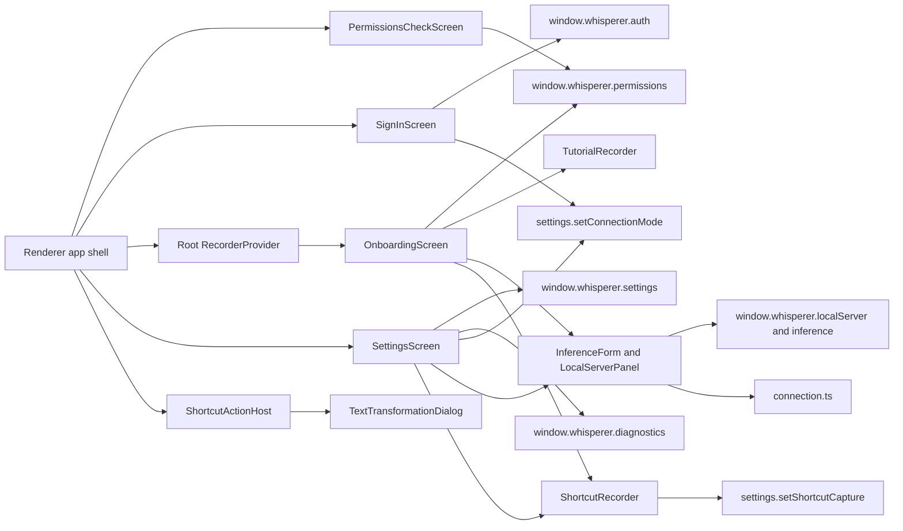

# Device setup and preferences

This feature owns renderer-only sign-in, device onboarding, and preference surfaces. It does not own capture engines, global shell navigation, native permission implementations, or server authentication.

## How it works

`DeviceSetupLayout` gives sign-in and onboarding the same titlebar progress and two panels. Its styling lives in `device-setup.css` and reads the hub font and the root `--setup-*` tokens in `renderer/styles.css`, so both screens follow the light or dark theme. The reference renders these pages in light mode only. Our light values match the reference and the dark values reuse the hub dark surfaces, because the renderer guide requires both themes.

`PermissionsCheckScreen` is the macOS preflight. `App.tsx` shows it before sign-in, onboarding or the hub while Microphone, Accessibility or Automation is missing, until the user continues for that launch. Each row has Allow, which requests or resets the permission, and Open System Settings. The screen rechecks on window focus so rows turn green after the user returns from System Settings. `permissionCheck.ts` holds the pure checklist rules. Automation is only known after a probe, so an unchecked state never opens the checklist on its own.

`SignInScreen` shows the sidebar logo for the active theme and fills its right panel with a theme gradient. It asks for the API server URL and starts the main process device sign-in. The submit button stays disabled until a URL is entered, and the server is saved only after main completes sign-in. The renderer never receives credentials. Below the form, Continue without signing in calls `settings.setConnectionMode('device')`, which selects the Whisperer server on this device without downloading anything.

In device mode, `OnboardingScreen` opens on an Inference step before the unchanged device steps, and `DeviceSetupLayout` shows the `Start · Inference · Permissions · Set up · Learn` rail from `setup-sections.ts`. `InferenceSetup.tsx` holds the two shared units used there and in Settings. `InferenceForm` chooses speech (on this device with a catalog or custom Hugging Face repo id, or an HTTP endpoint) and the language model (HTTP endpoint or Off), saves through `inference.update` and runs `inference.test` against saved choices. API key fields are write-only; the form shows only whether a key is saved. `LocalServerPanel` shows the server, speech and language model states from `useLocalServer`, which seeds from settings and follows `events.onLocalServerChanged`. Its actions come from `localServerActions`: Set up, Cancel, Retry or Restart, and Download model for a missing on-device model. Progress shows real bytes and states an unknown total instead of inventing a percentage. The activity log is collapsed by default and passes each line through `redactLogLine` as a second guard. Continue unlocks only when the server is running, speech is ready and the language model is ready or off. Custom models can only be named by repo id; importing model files from disk is not part of the contract and the form says so. `connection.ts` holds these pure rules plus the hub gate, the sidebar indicator copy and `connectionToggle`, which decides the top-bar cloud/device switch: it flips only when a remote session and the installed runtime both exist, and otherwise rests on the usable side, disabled, with a tooltip naming what to set up. `backendChanged` tells when a bootstrap update crosses backends inside the open hub, and `planBootstrap` decides whether `App` stages, restages, commits or cancels. `App` stages a crossing, fades the page out while it is inert, commits while it is hidden, and fades it back in while a ring crosses the outer shell from the toggle (top bar, sidebar and gutters, never the page). While a switch is landing the toggle reads Switching… and refuses another flip. Reduced motion and any state that leaves the hub commit at once with no animation.

`OnboardingScreen` has five steps that configure only this device. Permissions come first, then a microphone test, language, shortcut and the tutorial. A permission the platform does not support counts as resolved and shows the reason, so setup never waits on a service that does not exist. Only microphone access blocks Continue. Insertion access stays requestable but optional, because completed dictation falls back to the clipboard without it. The microphone test reuses the root recorder level and cancels its capture when confirmed. The shortcut step uses the shared `ShortcutRecorder`, `ShortcutChips` and `useShortcutKeyTest` for push to talk and hands free mode. Yes stays disabled until the chosen keys are actually pressed, and Edit shortcut saves `shortcutBindings` through the settings bridge. The tutorial keeps `TutorialRecorder` and cancels any capture before setup finishes.

`SettingsScreen` supplies the inner content of the Hub's modal Settings panel: General, System, Notetaker, Inference, MCP, Account, and Data and Privacy. MCP (`McpSettings.tsx`, pure helpers in `mcp-connect.ts`) explains that MCP syncs Notetaker with the user's AI app for meeting transcripts and notes only, never dictation, the dictionary or audio; it derives the connection URL `<server>/mcp` from the saved `apiHost`, copies it through `clipboard.copy`, and offers Copy-ready setup for Claude Code, Codex, Cursor and Gemini CLI plus the custom-connector steps for other apps. In Laptop mode or before sign-in it is visibly unavailable; it never opens URLs or talks to the network. Inference shows the server panel and then the model form in device mode, both in the same rounded row cards, title and type scale as the other categories (the `--settings` variants in `inference.css`; onboarding keeps its setup styling), and, in remote mode, explains that the server chooses its models with a Use this device instead action. Account shows Running on this device with Sign in to a server instead, or the remote server with Use this device instead. Main refuses a switch while capture or a transform is in flight and the refusal is shown as an alert. Data and Privacy names where dictation audio goes, offers Sync with your server (`dataSync.run`, enabled in device mode with a ready local server and a signed-in session) with an opt-in Sync automatically when the on-device server starts toggle (`syncAtStartup`), and, in device mode only, offers Delete on-device data: `ConfirmEraseLocalData` is an alert dialog that starts focused on Cancel, lists what is deleted and what stays, and enables Delete permanently only after the user types DELETE; it then calls `localData.erase`. Every mutable row calls a contract-approved `window.whisperer` operation. The Shortcuts modal presents each action in a compact card with up to four `ShortcutRecorder` chip bindings (Cancel has one), places its add button beside the last binding, opens an empty added binding directly in capture mode, checks loaded Transform shortcuts before save and shows conflicts as an alert, and keeps Reset to default and Done beneath the scroll area. It displays the hands-free double-tap readout only when native hold-to-talk is available. `shortcut-keys.ts` holds the key-test and native-suspension hooks. `TransformsScreen` owns autosaved local transform definitions, opt-in native shortcut registration, and the visibly unavailable post-dictation proposal preference. `transform-save-queue.ts` serializes editor writes, preserves edits made while a save is in flight, adopts a server-assigned custom identifier without overwriting newer fields, and flushes a valid draft before the editor closes. `ShortcutActionHost` receives only safe review sessions from main and uses `TextTransformationDialog` for review-first generation, copying, and conditional acceptance; it routes Notetaker after main starts a local meeting. Identity-provider profile fields, unsupported platform capabilities, and server-owned retention controls remain visibly read-only.

## Used by

`App.tsx` mounts sign-in when signed out, wraps onboarding in the root `RecorderProvider`, and renders Settings in the signed-in hub. The main process exposes its narrow typed bridge through `shared/contracts.ts`; this feature must not use network, Electron, Node, or generic IPC APIs.

## Structure

