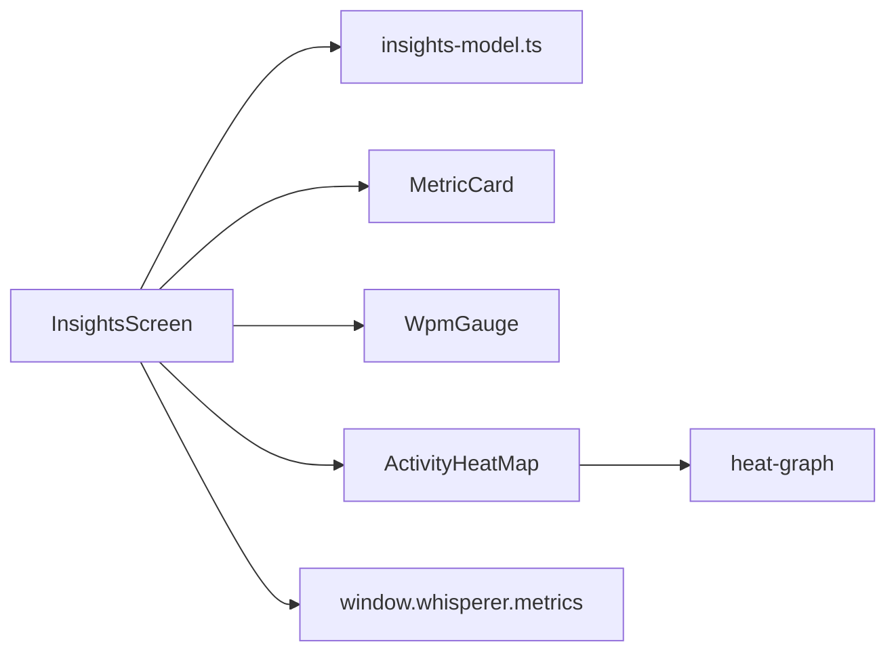
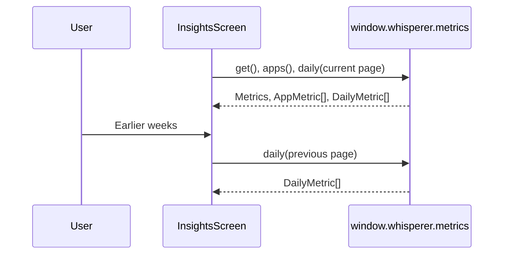

# Insights

The account-wide usage page: a grid of bounded metric cards (words per minute with a pace gauge, fixes made by Whisperer, total words with a month-over-month badge and book comparison, apps dictated into) and a paged, Sunday-first activity heat map of daily words that outlines the current day streak. `insights-model.ts` owns every derived display value; the components render what it returns.

## How it works

The screen reads `metrics.get()` for the account summary, `metrics.apps()` for the app list and `metrics.daily({ from, until })` for the heat-map page in view. A page is sixteen Sunday-based weeks; the current page ends today and earlier pages hold whole weeks, so paging back fetches one bounded range at a time and the previous page stays on screen while the next loads. The streak outline is derived from `dayStreak` and whether today has words. The gauge fills against a 200 wpm ceiling and captions the rate as a multiple of a 40 wpm typing pace. The month badge compares `wordsThisMonth` with `wordsLastMonth`; the book line divides lifetime words by 90,000.

## Used by

`App.tsx` mounts `InsightsScreen` on the `insights` route and imports `insights.css`. The main process answers the bridge from the authoritative API, so the page shows the same numbers in cloud and on-device mode once data has synced.

## Structure

`MetricCard` is the only card primitive; `MetricRow` and `InfoHint` sit inside it. `WpmGauge` and `ActivityHeatMap` are presentational and take their values as props. `insights-model.test.ts` pins the heat-map paging, gauge rank, book line, month delta and duration formatting.
