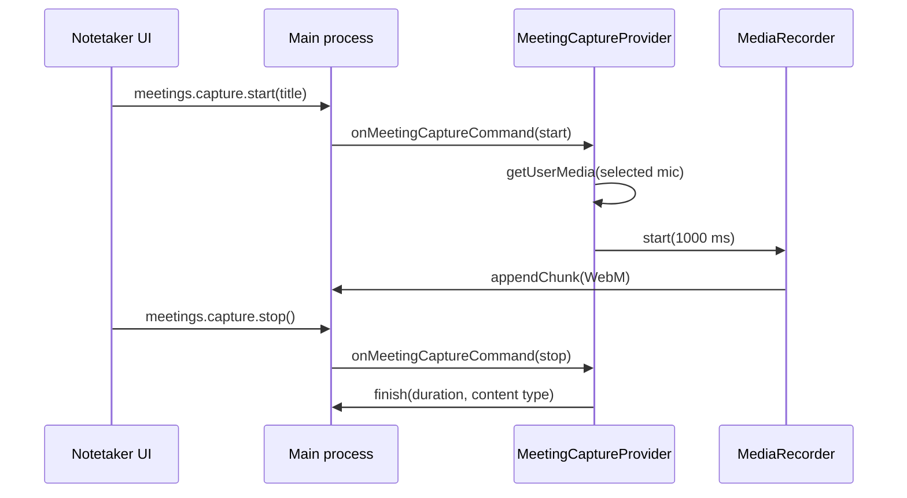

# Local meeting capture

This feature owns the authenticated hub's renderer-side microphone-only WebM capture for local meetings. It does not render the Notetaker screen, create meeting metadata, retain files, import/export audio, produce transcripts, or produce summaries.

## How it works

`MeetingCaptureProvider` waits for a typed main-process capture command before it calls `getUserMedia` with the selected microphone. It streams `MediaRecorder` WebM chunks in arrival order through the narrow bridge. On stop it drains that queue, measures duration, and asks main to finalize the local artifact. Generation checks prevent a cancelled acquisition or delayed chunk from reaching IPC.

A presentation-only AudioContext analyser samples the same open microphone stream every 150 ms through the recording feature's shared RMS envelope. It does not request another microphone or change the MediaRecorder artifact. Bounded `source: 'meeting'` meter events feed the green Notetaker pill and are never stored. Stop, cancel, failure and unmount close the analyser context and interval along with the recorder.

## Used by

`App.tsx` mounts the provider once around the authenticated hub. The Notetaker screen receives `useMeetingCapture()` actions and state as props. The provider uses named `window.whisperer.meetings`, `window.whisperer.recording.reportMeter`, and `window.whisperer.events` methods; main owns capture mutual exclusion, private files, import dialogs, and export dialogs.

## Structure

| Path | Responsibility |
| --- | --- |
| `MeetingCaptureProvider.tsx` | Browser capture lifecycle, bridge commands, resource cleanup, and hook. |
| `lifecycle.ts` | Pure stale-generation invalidation and serial chunk queue. |
| `lifecycle.test.ts` | Generation cancellation and chunk ordering behavior. |
| `index.ts` | Public renderer exports. |

System audio is deliberately unavailable: this feature asks only for a microphone, and never claims to capture meeting participants or to transcribe or summarize audio.
