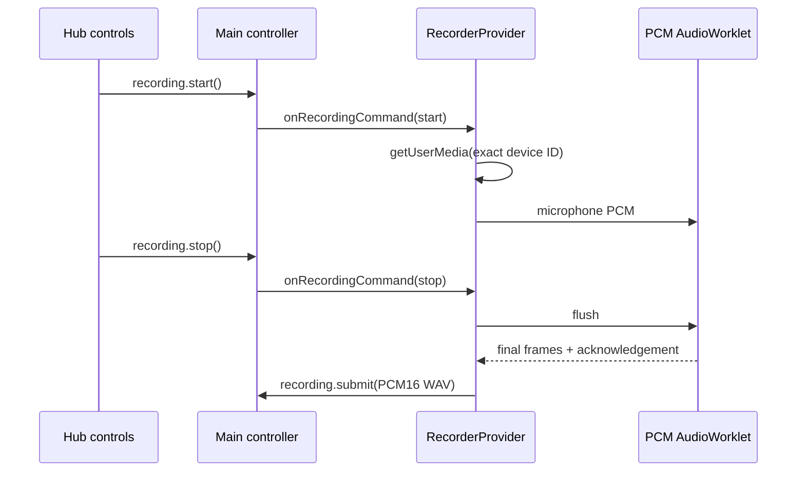
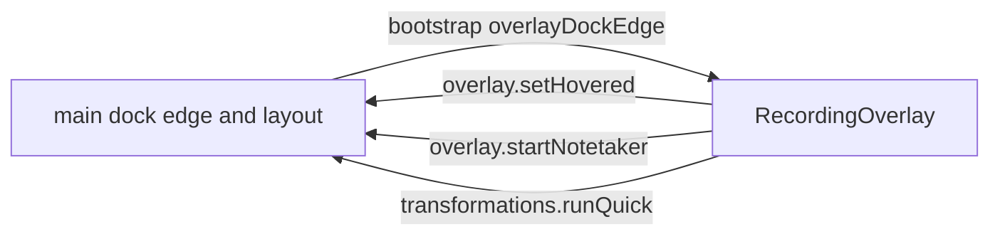

# Recording feature

This directory implements the renderer-side microphone pipeline and its React surfaces. It owns no Electron privilege: the typed preload bridge accepts lifecycle requests and receives the final WAV submission.

## How it works

`RecorderProvider` mounts once at the application root and is the only microphone owner. A UI button asks main to start, stop, or cancel. Main emits a command back to the hub; only that event invokes capture. This breaks the otherwise recursive command/event loop.

The provider acquires the selected device with an exact `deviceId` constraint when one is configured, feeds it into the local AudioWorklet, and retains mono PCM packets. `pcm-worklet.js` mixes channels to mono and acknowledges a final flush. After acknowledgement, `wav.ts` encodes PCM16 WAV bytes. The provider bounds packets by duration and the 25 MiB final-file limit, then submits a `Uint8Array` only if its generation remains current.

When the pointer rests on the idle pill it widens to show the mic and, while Transforms are on, a sparkle button for the first transform in the list (Polish by default). The button applies the transform in place, just like its shortcut. Push to talk and processing show a cancel button beside the waveform or spinner, as hands-free already does. Cancelling while processing aborts the transcription request and drops any late result.

`RecordingOverlay` also shows a running transform shortcut. While main reports `transform.phase === 'applying'`, the pill widens and shows "Applying <name>…" with a sweeping sheen and spinner. `TransformPopup` renders in its own non-focusing window above the pill. It says the transform was applied (or why it was not) and offers See changes, which expands a red/green word comparison built by `shared/textDiff.ts`. An untouched notice closes after a few seconds; hovering or expanding it keeps it open.

## Used by

`App.tsx` mounts `RecorderProvider` around the hub and onboarding. Home uses `RecorderControls`, onboarding uses `TutorialRecorder`, and the overlay window uses `RecordingOverlay`.

## Structure

The provider owns the audio graph. Controls and overlay only read provider or main state. `wav.ts` and `lifecycle.ts` are pure helpers.

## UI surfaces

| Export | Responsibility |
| --- | --- |
| `RecorderProvider` / `useRecorder` | Single capture owner and lifecycle state. |
| `RecorderControls` | Hub buttons, elapsed time, level meter, feedback, retry and cancellation. |
| `RecordingOverlay` | Provider-free compact bottom-center status presentation driven by main state; it never opens a microphone and can expose a main-owned scratchpad action. |
| `TutorialRecorder` | Reuses the mounted provider for the onboarding tutorial; Home has only the primary recorder. |

`RecordingOverlay` receives lifecycle snapshots from main and an independent `onRecordingMeter` event. It presents a 40×8 resting handle, 50×30 hover microphone, 102.5×30 handsfree pill with cancel/finish circles, a 73×30 push-to-talk waveform, a processing spinner, and a transient red error border. The Notetaker variant uses five green bars and its existing stop action. It never shows internal capture-phase strings or constructs an audio graph.

`AudioMeterEnvelope` measures actual mono PCM, learns a noise floor bounded at −60 dB, normalizes a 20 dB speech range, and applies attack/release smoothing. The hub relays bounded measurements at a 150 ms cadence through `recording.reportMeter`, without persistence or full bootstrap updates. The overlay smooths that target into ten bounded center-bulged bars (five for Notetaker); silence stays at the 2 px floor.

Pointer gestures on the handle or waveform cross the overlay-only drag bridge. Main reads cursor coordinates, applies the 5 px movement threshold, clamps to the current display, and persists only the chosen bottom/left/right edge. Action circles are not drag surfaces.

Main publishes the dock edge in the bootstrap state. On the left or right edge the bar turns 90 degrees: `overlayPillSize` swaps width and height, the pill stacks its controls, and waveform bars grow sideways.

The hovered ready pill adds separate circles from `overlayHoverActions`: Start Notetaker (`overlay.startNotetaker`, which runs the Notetaker shortcut action), the first transform (`transformations.runQuick`) and, when enabled, scratchpad. Each control slides out a tooltip with its name and shortcut, above a bottom bar or toward the screen interior from a side bar. `overlayWindowLayout` gives main and the renderer one geometry: while actions show, the window reserves transparent tooltip room and main grows it away from the edge, so the bar does not move. Only the visible bar owns hover, and a leave collapses it only if the pointer is really gone, because a resize under a still cursor can report a false leave.

## Files

| Path | Purpose |
| --- | --- |
| `RecorderProvider.tsx` | Capture lifecycle, bridge coordination and generation cancellation. |
| `pcm-worklet.js` | Independent AudioWorklet PCM mixer and flush protocol. |
| `wav.ts` | Pure PCM16 WAV encoder. |
| `lifecycle.ts` | Pure stale-work invalidation controller. |
| `meter.ts` | Real PCM speech envelope shared with the existing meeting capture stream. |
| `overlay.css` | Black pill geometry, vertical side-dock layout, hover action circles, slide-out tooltips, waveform and processing spinner. |
| `*.test.ts` | Unit coverage for WAV encoding and cancellation generation behavior. |
