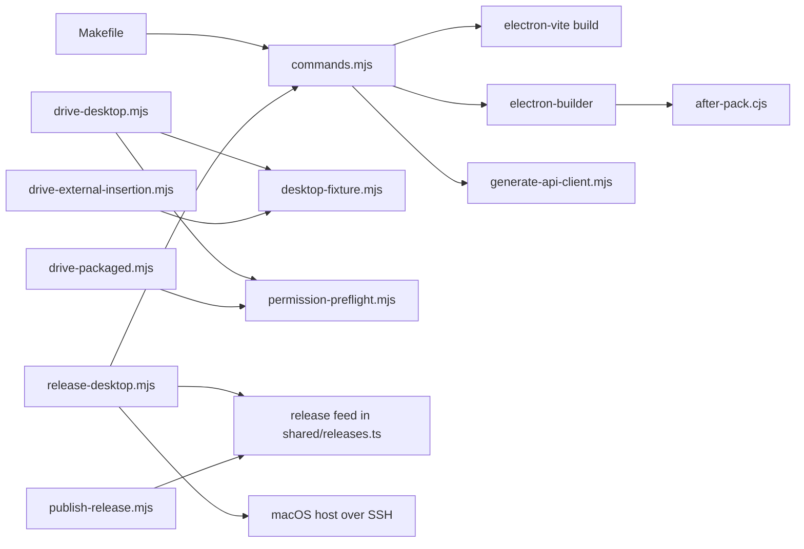

# tools

Portable command, generation, packaging, acceptance and release tooling.

## How it works

Every `make` target runs `node tools/commands.mjs <target>`, so the same commands work under GNU Make on Windows without POSIX shell recipes. Run `make help` for the list.

- `make linux`, `make windows` and `make dmg` build installers. Windows builds natively on Windows or through the pinned Wine toolchain in `Dockerfile.windows` elsewhere.
- `make stack-up`, `stack-down`, `stack-status` and `stack-config` run the [deploy](../deploy/README.md) overlays as the separate Compose project `whisperer-stack`, taking the stack from `STACK` or detecting local hardware.
- `make api-setup` runs `uv sync` with `--extra local`, so CI installs the on-device speech runtime and covers the PyAV decode and ONNX tests. A production remote install does not use that extra.
- `release-desktop.mjs` builds one committed revision on Linux, Windows in Docker and a macOS host you name over SSH. It collects ignored installers, checksums and a manifest without publishing them. `publish-release.mjs` publishes a verified output. [Desktop release](../docs/desktop-release.md) defines naming and versioning.

## Used by

Make targets, CI, API contract generation and packaging call these tools.

## Structure

Packaging calls electron-builder, which runs `after-pack.cjs` to set Electron fuses. Acceptance launches the real desktop against the loopback fixture with a disposable Electron profile. It drives sign-in and the device-setup steps in light and dark themes, records shortcuts through DOM key events and checks the native overlay through a Chromium fake microphone. On Linux it also uses real X11 pointer input to verify pill movement, edge docking and click suppression; elsewhere those checks are skipped with a warning. Pass `--verbose` for diagnostic dumps.

| Path | Responsibility |
| --- | --- |
| `commands.mjs` | Implements the portable `make` targets. |
| `check-folder-docs.mjs` | Backs `make docs-check`: every tracked folder has `AGENTS.md` and the exact `CLAUDE.md` shim, and every existing `README.md` has a Mermaid diagram and links its child READMEs. |
| `after-pack.cjs` | Flips Electron security fuses on every packaged executable. |
| `generate-api-client.mjs` | Generates and compiles the TypeScript API client from `apps/api/openapi.json`. |
| `desktop-fixture.mjs` | Serves synthetic loopback API responses for acceptance runs. |
| `drive-desktop.mjs` | Drives the built desktop end to end against the fixture: device setup, shortcut rebinding, the recording overlay, notes, Notetaker, transcript editing, meeting questions, history, the backend toggle and its transition, sidebar tooltips and sign-out, in both themes. |
| `drive-external-insertion.mjs` | Drives X11 global-shortcut dictation and transform hotkeys into fixture-only external Chromium text areas and checks the clipboard fallback. Requires X11, `xdotool`, `xclip`, Chromium and an EWMH window manager. |
| `drive-packaged.mjs` | Launches a fused packaged executable over Chromium CDP and checks the sandboxed sign-in screen. |
| `permission-preflight.mjs` | Shared acceptance step that continues past the macOS permission checklist only while a permission is missing. |
| `release-desktop.mjs` | Archives one commit, requires a semantic `package.json` version, builds and validates installers named `Whisperer-<version>-<os>-<arch>.<ext>`, then writes checksums and a resumable manifest outside tracked source. macOS host defaults may come from a per-user `release.json` outside the checkout. |
| `publish-release.mjs` | Verifies a release output's manifest, names and checksums, then creates tag `v<version>` on the configured GitHub or Gitea release feed and uploads the installers. |
| `build-macos.sh`, `build-windows.sh` | Thin shell wrappers around `commands.mjs dmg` and `commands.mjs windows`. |
| `Dockerfile.windows` | Defines the Docker-based Windows packaging toolchain. |
