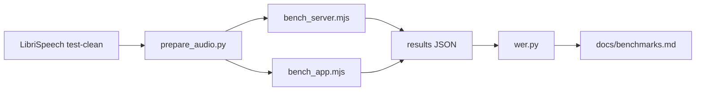

# benchmark

Scripts behind [docs/benchmarks.md](../../docs/benchmarks.md). They measure the released Windows build with public LibriSpeech audio: transcription speed and accuracy, dictation latency, cold start, memory and network egress.

## How it works

`prepare_audio.py` turns LibriSpeech test-clean into an hour of audio, its 48 kHz dictation-sized parts, a WebM meeting segment and 20 short clips. `bench_server.mjs` starts the released on-device server the way the desktop does and sends that audio through its transcription and meeting endpoints. `bench_app.mjs` drives the packaged app itself for dictation, cold start, idle memory and the privacy session. `wer.py` scores every transcript with jiwer. `run_all.sh` runs the phases in order and resumes after an interruption. `bench_server.mjs` stops a run and records it as skipped when free memory falls below 600 MB, and `bench_app.mjs` pauses dictation when the target window loses focus on 3 clips in a row.

| Entry | Role |
| --- | --- |
| `prepare_audio.py` | Builds the hour, its 4 minute 48 kHz WAV parts, the 24 kbit/s Opus WebM segment and the 10 second clips with their references. |
| `bench_server.mjs` | Engine and meeting runs against the released `serve-local`, with model load time and peak memory. |
| `bench_app.mjs` | Packaged app runs: setup, cold start, dictation latency into a separate window, idle memory, privacy session. |
| `wer.py` | Word error rate against the references, lowercase with punctuation removed. |
| `window_check.py` | Read-only diagnostic: reruns the released inference code over the hour with a different decoding window length. |
| `run_tests.sh` | Fresh API, desktop and end-to-end test runs with coverage. |
| `run_all.sh` | Runs every phase in sequence and skips finished ones. |
| `conditions.ps1` | Logs free memory, CPU load and AC power before each phase. |
| `memsample.ps1` | Samples the memory of a process tree. |
| `egress-win.ps1` | Logs every non-loopback TCP connection of the app's process tree. |
| `target-win.ps1` | A plain text window that receives dictation and mirrors its text to a file. |
| `stub_gateway.py` | A loopback stand-in for an OpenAI-compatible endpoint, used for the meeting summary in the privacy session. |
